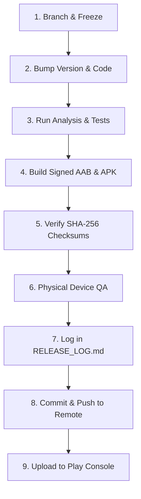

# Simple AAC Sri Lanka — Official Release & Build Register

This document is the single source of truth for all production releases, release candidates, build versions, git commits, branches, and release artifact checksums for **Simple AAC Sri Lanka** (`lk.yasas.simpleaac`).

---

## 1. Master Release Register

| Version | Build (`versionCode`) | Release Date | Git Branch | Commit SHA | Production AAB (SHA-256) | Universal APK (SHA-256) | Google Play Status |
| :--- | :---: | :---: | :--- | :---: | :--- | :--- | :--- |
| **v1.1.6** | **16** | 2026-11-23 | `release/play-store-rc-20261121-v1.1.6` | `f40a6c6` | `96fbeecc77a7fbc22d252ce9e83f3534247ad07a9412a92826f464e0a05b8bbe` | `ad728a057864459ad5e4ad1b7b75b9f93ee74f2619ca24843b0ce938ae2b8519` | **Production Release Package** |
| **v1.1.6** | **15** | 2026-11-21 | `release/play-store-rc-20261121-v1.1.6` | `e40bdbb` | *(Superseded by Build 16)* | *(Superseded by Build 16)* | Production Draft (Replaced) |
| **v1.1.5** | **14** | 2026-11-20 | `release/play-store-rc-20261120` | `a5d717f` | `1021bc62b254a6dbb8c1995ec257f0f622cf64ad930bfe7bb30a5ca4fb90e8a8` | `43fb0759048a1c93a0279c13ee0c04245fcb6214b2d56a0c0dbf11ce716a4c28` | In Review (Google Play) |
| **v1.1.4** | **12** | 2026-11-16 | `main` / `feature/multi-category-selection` | `98ccc45` | `d0c1592383be550e58fa2f5a2b1f13b631d5828a2a0a256955fc199c0dae7bf9` | `321f4ae8b7468165d2c2068aa9a51bf87413550b1d3d19ebf4d54832ebaa1109` | Deployed |
| **v1.1.3** | **11** | 2026-11-16 | `feature/v1.1.3-category-ui-polish` | `8dfe355` | `71ae2a87d6052f7aa56c36142cc5d1be8b7b37f481c4e7f8641bc2275464192b` | `4cfc14101e4ec32b9894e6341270bc227926b48455e88eef043da1b379b37c02` | Deployed |
| **v1.1.2** | **10** | 2026-11-16 | `feature/v1.1.1-settings-live-previews` | `2eece9a` | `e97a3bf236166e927c3f3747eb11be86dfc99b8f2d5ee5220c430e76fb3a54b3` | `1b855e975871f3014c274b79144415865a7f92ca9e875aa3c34a2608d27fe8fb` | Certified & Deployed |
| **v1.1.1** | **9** | 2026-11-16 | `feature/v1.1.1-settings-accessibility` | `ce550e8` | `8c6085a6f272a8cb9e680a67be04a37ef8544a4d6423c52e698ef6f03027efea` | `a3e144a991823eb29e6fb69486ad9a58434685ff42903c004d80dcf2594a282f` | Certified & Deployed |
| **v1.1.0** | **8** | 2026-11-14 | `release/play-2026-11-14` | `d205b68` | `4e8e19273c52aa01a93e3d1ba6085441d40a23c54532a24558e65ea0e93fa112` | `c87aa9166f27c3ea4502d91bb6105445d40a23c54532a24558e65ea0e93fa223` | Deployed |
| **v1.0.0** | **1** | 2026-11-04 | `release/play-v1.0.2` | `e6fc156` | — | — | Initial Play Store Release |

---

## 2. Release-by-Release Detailed Logs

### Release v1.1.6 (Build 16) — November 23, 2026
* **Application ID:** `lk.yasas.simpleaac`
* **Version String:** `1.1.6`
* **Version Code:** `16`
* **Git Commit:** `f40a6c6700754d13969f21d322e037dcc0c84680`
* **Branch:** `release/play-store-rc-20261121-v1.1.6`
* **AAB Path:** `/home/yasas/Desktop/SimpleAAC-v1.1.6-Build16-FINAL.aab`
  * **SHA-256:** `96fbeecc77a7fbc22d252ce9e83f3534247ad07a9412a92826f464e0a05b8bbe`
* **APK Path:** `/home/yasas/Desktop/SimpleAAC-SriLanka-v1.1.6-Build16-FINAL.apk`
  * **SHA-256:** `ad728a057864459ad5e4ad1b7b75b9f93ee74f2619ca24843b0ce938ae2b8519`
* **Mapping File:** `SimpleAAC-v1.1.6-Build16-mapping.txt`
* **Key Enhancements & Bug Fixes:**
  1. **Text-to-Speech Bar Colour Setting:** Added independent Light and Dark mode colour customization for the sentence bar with live preview, quick presets, and hex input.
  2. **Harmonized British English UI Strings:** Updated user-facing labels to British English (`Colour`, `Colours`) while preserving internal database keys, Flutter APIs, and serialization format.
  3. **Dark Mode Seamless Card Insets:** Eliminated white rectangular insets behind transparent icons on nested cards in Dark Mode using seamless pastel background fills.
  4. **Active Folder-Stack State Restoration:** Restored full folder navigation stack upon Android system process recreation or device memory reclamation.
  5. **Camera Draft & Recreation Recovery:** Resolved high-resolution camera photo capture memory pressure; returning safely to Card Editor with full draft preservation.
  6. **Full Screen Settings Preference:** Persisted user preference for full-screen vs compact drawer settings view across application restarts.
* **Test Verification:**
  * Automated Suite: 708 tests passing (`0 failures`).
  * Static Analysis: `0 errors`, `0 warnings`, `0 lints` (`flutter analyze`).
  * Physical Device QA: Verified on Samsung Galaxy A34 (One UI 6.1 / Android 14).

---

### Release v1.1.5 (Build 14) — November 20, 2026
* **Git Commit:** `a5d717f` / `0d069b2`
* **Branch:** `release/play-store-rc-20261120`
* **Key Enhancements:**
  1. **Transactional Edit Mode:** Drag-and-drop card reordering, move into subcards, multi-step undo, and Cancel/Done session controls.
  2. **30-Day Recycle Bin:** Safe soft-delete with media reference counting and retention.
  3. **Crop & Zoom 1:1:** Photo cropping for camera capture and gallery imports.
  4. **Animated Splash:** Themed splash screen with zero black-flash transition.
  5. **180-Degree Rotation:** Full landscape orientation support for tablets and accessibility mounts.

---

### Releases v1.1.1 to v1.1.4 (Builds 9–12) — November 16, 2026
* **Build 12 (`98ccc45`):** Multi-category selection dialog and category management.
* **Build 11 (`8dfe355`):** Keyboard-aware Add Category dialog and category UI polish.
* **Build 10 (`2eece9a`):** Live preview dialogs for settings, appearance, and backup/restore.
* **Build 9 (`ce550e8`):** Accessibility enhancements, high-contrast mode, and color vision deficiency simulations.

---

## 3. Mandatory Release Workflow (SOP) for Future Builds

Whenever preparing a new build or Google Play update, follow this strict step-by-step checklist:



### Step 1: Branch Creation & Code Freeze
* Never build a production release from an uncommitted or dirty tree.
* Create a dedicated release branch:
  ```bash
  git checkout -b release/play-store-rc-YYYYMMDD-vX.Y.Z
  ```

### Step 2: Version Bump in `pubspec.yaml`
* Update `pubspec.yaml`:
  ```yaml
  version: 1.1.7+17 # Format: X.Y.Z+<versionCode>
  ```
* Ensure `versionCode` is strictly greater than the previous release (e.g., 17 > 16).

### Step 3: Automated Verification
* Run static analysis and unit test suite:
  ```bash
  flutter analyze
  flutter test
  ```
* All tests must pass with 0 failures and 0 analyzer issues.

### Step 4: Build Signed Production Artifacts
* Clean build cache:
  ```bash
  flutter clean
  flutter pub get
  ```
* Build Production AAB:
  ```bash
  flutter build appbundle --release
  ```
* Generate Universal APK for physical QA & caregiver distribution:
  ```bash
  bundletool build-apks \
    --bundle=build/app/outputs/bundle/release/app-release.aab \
    --output=build/app/outputs/bundle/release/app-release.apks \
    --mode=universal \
    --ks=android/app/upload-keystore.jks \
    --ks-pass=file:android/key.properties \
    --ks-key-alias=upload \
    --key-pass=file:android/key.properties
  
  unzip -p build/app/outputs/bundle/release/app-release.apks universal.apk > build/app/outputs/apk/release/app-release-universal.apk
  ```

### Step 5: Checksum Generation & Logging
* Calculate SHA-256 for all deliverables:
  ```bash
  sha256sum build/app/outputs/bundle/release/app-release.aab
  sha256sum build/app/outputs/apk/release/app-release-universal.apk
  ```

### Step 6: Update `RELEASE_LOG.md`
* Record the new Version, Build, Commit SHA, Branch, Checksums, and change notes in Section 1 and Section 2 of this file.

### Step 7: Commit & Push
* Commit changes:
  ```bash
  git add pubspec.yaml RELEASE_LOG.md
  git commit -m "chore(release): bump version to vX.Y.Z (build N) and update release log"
  git push -u origin release/play-store-rc-YYYYMMDD-vX.Y.Z
  ```

### Step 8: Play Console Upload & Submission
* Upload signed AAB to Google Play Console (Production, Closed Testing, or Internal Track).
* Attach `mapping.txt` for de-obfuscation.
* Verify version code, permissions, and release notes before submitting for review.
