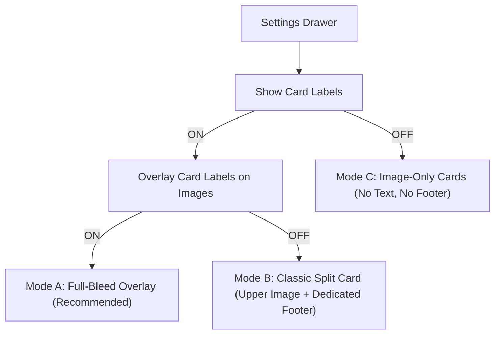

# Simple AAC Sri Lanka — Visual & Presentation Modes QA Report (v1.1.6)

**Report Date:** November 21, 2026  
**Application Version:** Simple AAC Sri Lanka v1.1.6 (Build 15)  

---

## 1. Overview of the Three Independent Card Presentation Modes

Simple AAC Sri Lanka provides two independent global display settings:
1. **Show Card Labels** (Toggle: ON / OFF, Default: ON)
2. **Overlay Card Labels on Images** (Toggle: ON / OFF, Default: ON)

Together, these settings govern the three distinct visual presentations:

---

## 2. Visual Mode Specifications & Behavioral Parity

### **Mode A — Overlay ON (Default / Recommended)**
- **Configuration:** `Show Card Labels = ON`, `Overlay Card Labels on Images = ON`
- **Visual Appearance:**
  - The image/photo fills the full card face corner-to-corner.
  - The card label is positioned at the bottom over the image.
  - A subtle dark gradient overlay is rendered behind the label to guarantee high text contrast across bright or light backgrounds.
  - Zero solid-colored footer band.
- **Cropping & Sizing:**
  - Seed illustrations and folder cards are rendered with proper aspect ratio without stretching.
  - User camera photos preserve the full confirmed crop.

### **Mode B — Overlay OFF (Classic Separation)**
- **Configuration:** `Show Card Labels = ON`, `Overlay Card Labels on Images = OFF`
- **Visual Appearance:**
  - Card is divided into two sections:
    - **Upper section (76% height):** Displays the card image/photo.
    - **Lower section (24% height):** Solid colored footer band with centered label text.
- **Cropping & Viewport Fill:**
  - User camera/gallery photos and folder cover images expand with `BoxFit.cover` to fill the upper image area completely (`width: double.infinity, height: double.infinity`), eliminating unwanted letterboxing or pillarboxing borders.
  - Seed illustrations preserve their transparent background and match the card surface color.

### **Mode C — Image Only (Labels OFF)**
- **Configuration:** `Show Card Labels = OFF` (regardless of Overlay setting)
- **Visual Appearance:**
  - 100% clean, distraction-free visual cards.
  - No text label, no footer band, and no dark gradient overlay.
- **Accessibility & Interaction Parity:**
  - Tapping still speaks the card title through TTS in English, Sinhala, or Tamil.
  - Tapping still adds the token to the sentence bar.
  - Screen reader semantics (`Semantics(label: card.title)`) remain completely accessible.

---

## 3. Visual Artifacts Attached

The following visual artifacts are included in this QA package:
- `three_modes_comparison_verified.png` — Side-by-side comparison of Mode A, Mode B, and Mode C.
- `mode_1_overlay_on.png` — Detailed rendered capture of Mode A.
- `mode_2_overlay_off.png` — Detailed rendered capture of Mode B.
- `mode_3_image_only.png` — Detailed rendered capture of Mode C.
- `default_card_before_after_comparison.png` — Before/After comparison of the Home Default folder cover.
