# Simple AAC Sri Lanka — User Guide (v1.1.0)
**Your Complete Manual for Daily Communication, Customization, and Accessibility**

---

## Table of Contents
1. [Chapter 1: Getting Started with Simple AAC](#chapter-1-getting-started-with-simple-aac)
2. [Chapter 2: Speaking and Sentence Composition](#chapter-2-speaking-and-sentence-composition)
3. [Chapter 3: Customizing Cards and Multilingual Content](#chapter-3-customizing-cards-and-multilingual-content)
4. [Chapter 4: Animated GIFs and Video Loops](#chapter-4-animated-gifs-and-video-loops)
5. [Chapter 5: Folders and Category Organization](#chapter-5-folders-and-category-organization)
6. [Chapter 6: Appearance, Themes and Haptic Feedback](#chapter-6-appearance-themes-and-haptic-feedback)
7. [Chapter 7: Safety, Board Pinning and Child Lock](#chapter-7-safety-board-pinning-and-child-lock)
8. [Chapter 8: Data Backup, Restore and Offline Privacy](#chapter-8-data-backup-restore-and-offline-privacy)

---

## Chapter 1: Getting Started with Simple AAC

Simple AAC Sri Lanka is an augmentative and alternative communication (AAC) platform engineered specifically for non-verbal children, individuals with autism, speech delays, aphasia, or stroke recovery. 

Built with an offline-first philosophy, Simple AAC provides instantaneous speech playback in English, Sinhala, and Tamil without requiring any internet connection or cloud subscription.

### Main Interface Overview

When you launch Simple AAC, you are greeted by the clean, calming default Blue Gradient theme designed to maximize readability and reduce sensory overstimulation.

*Figure 1.1: The Simple AAC Home Screen showing the Blue App Header, Sentence Composer Bar, and High-Contrast AAC Communication Cards.*

The interface is structured into three primary areas:
1. **Top Application Bar**: Contains the **Pin Board** security lock button on the left, the **Simple AAC** title in the center, and the **Menu (Drawer)** button on the right.
2. **Sentence Composer Bar**: Displays the sequence of words selected by the user, complete with immediate auditory playback and intuitive editing controls.
3. **AAC Card Grid**: A responsive, high-contrast grid of visual communication symbols designed for easy targeting by small fingers or individuals with fine-motor challenges.

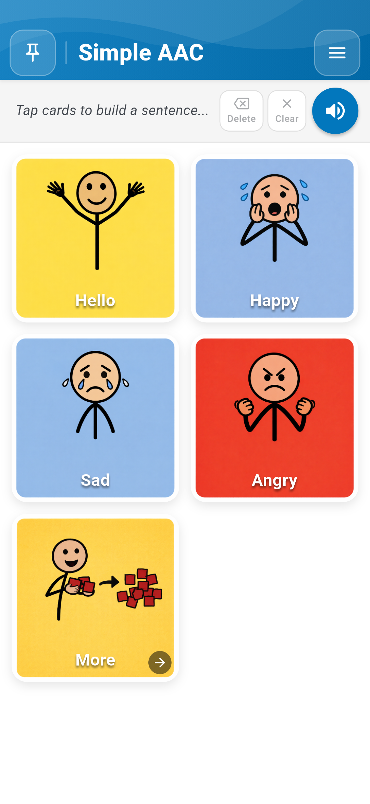
*Figure 1.2: High-contrast AAC Communication Cards with clear typography and universally recognized visual pictograms.*

---

## Chapter 2: Speaking and Sentence Composition

### 2.1 Tapping to Speak
Communication begins with a single touch. Simple AAC provides dual-mode auditory feedback:
- **Instant Speech**: When **Tap to Speak** is enabled in Settings, touching any card immediately speaks its label using offline Text-to-Speech (TTS) or custom recorded voice.
- **Haptic Pop**: Every touch triggers an authentic physical vibration and subtle visual pop effect, confirming the selection for tactile learners.

*Figure 2.1: Live demonstration of tapping cards, building sentences, and hearing continuous speech output.*

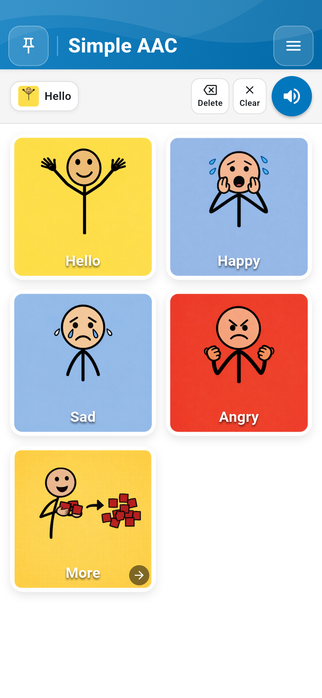
*Figure 2.2: Tapping the "Hello" card places it onto the sentence bar and triggers immediate speech playback.*

### 2.2 Constructing Multi-Word Sentences
Users can express complete thoughts by tapping multiple cards in sequence.

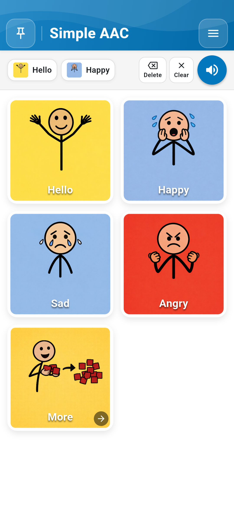
*Figure 2.3: Building compound sentences ("Hello" + "Happy") in the Sentence Composer Bar.*

Controls available in the Sentence Bar:
- **Delete (Back Arrow)**: Removes the most recently added card from the end of the sentence.
- **Clear**: Empties the entire sentence bar in one tap.
- **Speak Sentence (Speaker Button)**: Speaks the entire constructed sentence fluently from left to right.

---

## Chapter 3: Customizing Cards and Multilingual Content

Every individual communicates differently. Simple AAC allows caregivers, speech therapists, and educators to personalize every card.

### 3.1 Enabling Edit Mode
1. Tap the **Menu Button** (top right) to open the Settings Drawer.
2. Select **Enable Edit Mode**.
3. The board enters customization mode: cards display a red trash-can badge, and an **Add New** action bar appears at the top.

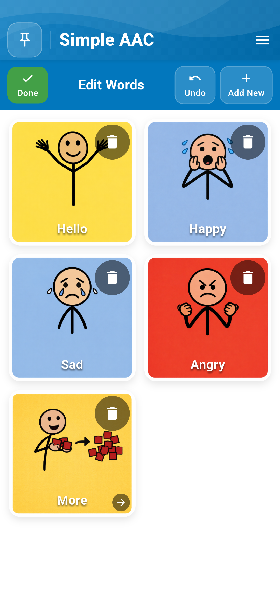
*Figure 3.1: Edit Mode active with "Add New" button and individual card delete badges.*

### 3.2 The Card Editor Dialog
Tapping any card in Edit Mode opens the comprehensive **Edit Card Dialog**.

*Figure 3.2: Card Editor Dialog with options for Web Search, Gallery, Camera, GIF import, multilingual labels, and voice recording.*

### 3.3 Adding Authentic Photos via Camera and Gallery
- **Camera**: Tap **Camera** to capture real-world items (e.g., child's own water bottle, favorite toy, family members). The app automatically requests standard Android camera permissions if not previously granted.
- **Gallery**: Tap **Gallery** to select high-resolution family photos or customized therapy pictograms from device storage.

*Figure 3.3: Direct Camera capture integration for personalized real-world item cards.*

### 3.4 Smart Image Search (Safe Search)
When Online Features are enabled by the caregiver, the **Smart Search** tool provides a curated library of child-safe visual concepts.

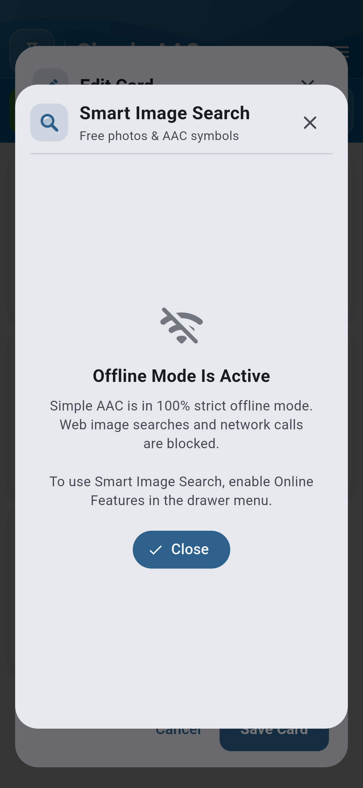
*Figure 3.4: Child-safe Smart Image Search interface.*

### 3.5 True Multilingual Support (English, Sinhala, Tamil)
Simple AAC supports Sri Lanka's official languages with native trilingual input:
- **English Label**: Standard international English terminology.
- **Sinhala Label (සිංහල)**: Authentic Sinhala Unicode text (e.g., හෙලෝ, සතුටුයි, වතුර).
- **Tamil Label (தமிழ்)**: Authentic Tamil Unicode text (e.g., வணக்கம், மகிழ்ச்சி, தண்ணீர்).

*Figure 3.5: Trilingual label editor supporting English, Sinhala, and Tamil simultaneously.*

### 3.6 Custom Voice Recording
For children who respond best to a parent's or therapist's familiar voice:
1. Tap **Record Voice** in the Card Editor.
2. Speak clearly into the microphone.
3. Tap **Stop** to save. The recorded audio takes precedence over synthesized TTS whenever the card is tapped!

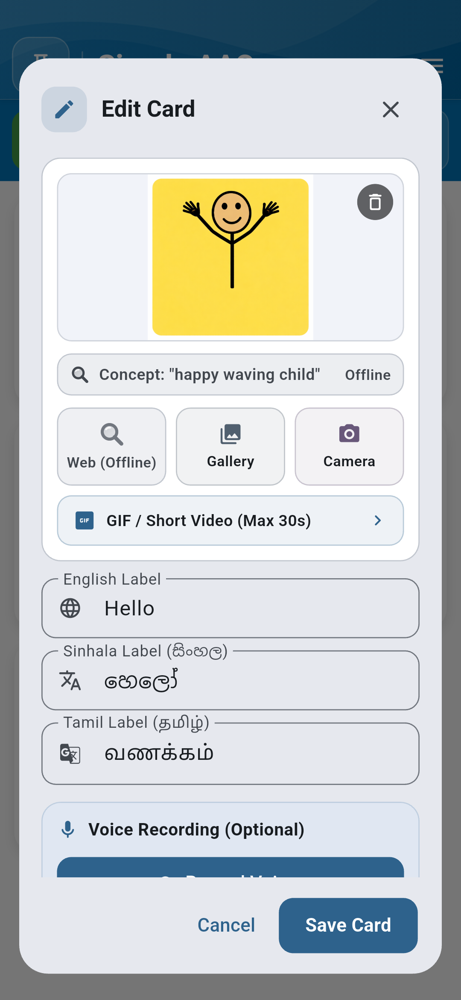
*Figure 3.6: High-fidelity custom voice recording interface.*

---

## Chapter 4: Animated GIFs and Video Loops

Visual learners and children with ASD often comprehend dynamic actions (such as *jumping*, *drinking*, *washing hands*) significantly better through animation than static images.

### 4.1 Importing Animated GIFs
Simple AAC includes a dedicated high-performance GIF engine that loops animated actions smoothly without draining battery power.

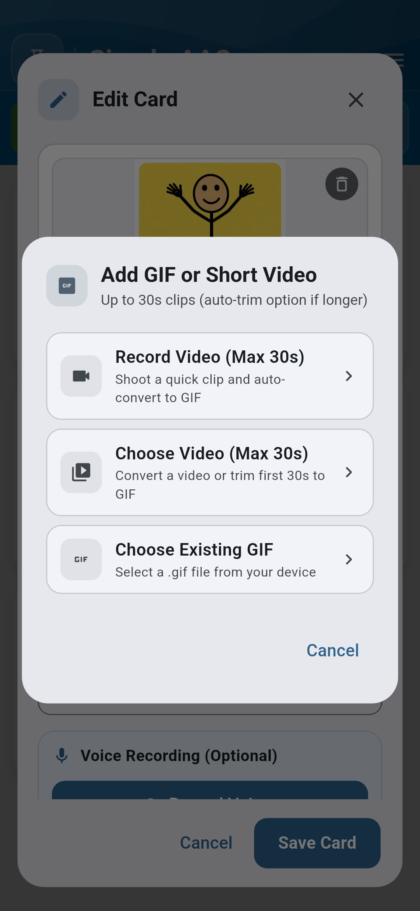
*Figure 4.1: GIF import dialog supporting loopable action animations.*

### 4.2 Converting Short Videos to GIFs
Caregivers can record short video clips (up to 30 seconds) of actual therapies, routines, or sign language gestures, and Simple AAC automatically converts them into lightweight, battery-efficient animated card loops.

*Figure 4.2: Integrated short-video to GIF converter for motion-based AAC cards.*

---

## Chapter 5: Folders and Category Organization

As vocabulary grows, cards can be neatly grouped into categories (e.g., *Feelings*, *Food & Drink*, *School*, *Activities*).

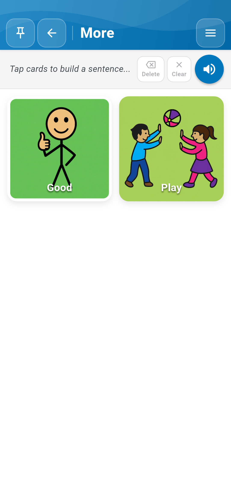
*Figure 5.1: Navigating into subfolders and category decks ("More ->").*

Tapping a folder card smoothly navigates into the category deck, presenting related vocabulary while retaining the persistent sentence composer bar at the top.

---

## Chapter 6: Appearance, Themes and Haptic Feedback

### 6.1 Settings Drawer
Access the Settings Drawer by tapping the top-right Menu button at any time.

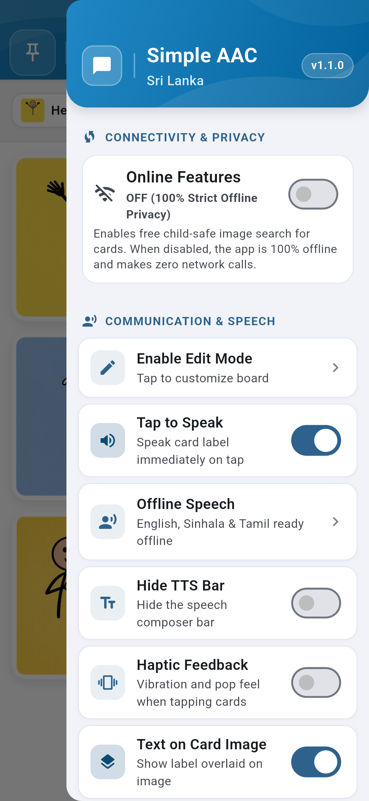
*Figure 6.1: Main Settings Drawer showing version 1.1.0, Offline status, Speech options, and Haptic Feedback toggle.*

### 6.2 Redesigned Color Customization
Simple AAC v1.1.0 features brand-new visual Color Pickers equipped with live interactive preview canvases:

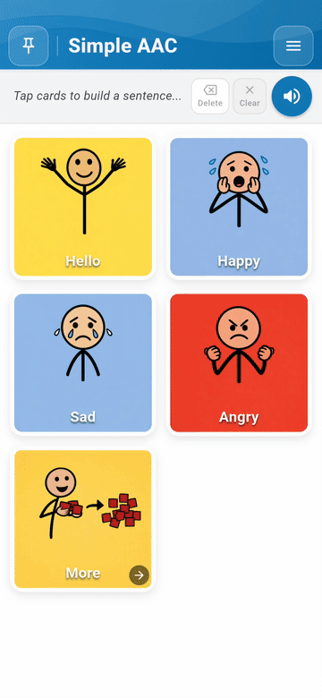
*Figure 6.2: Live demonstration of opening the Settings Drawer and fine-tuning application colors.*

1. **Primary App Color**: Adjusts the header, buttons, and primary accents.
   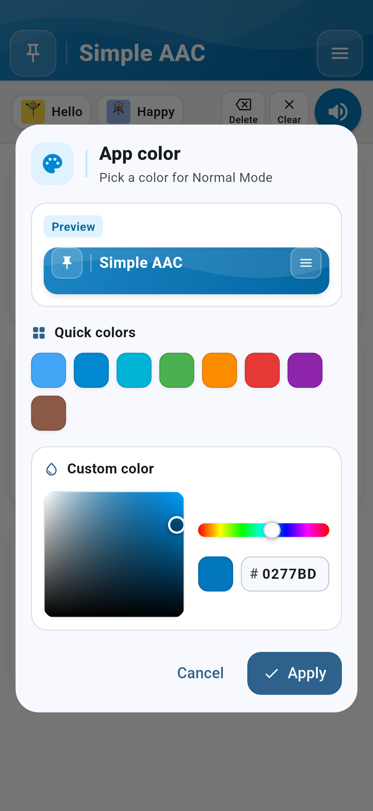
   *Figure 6.3: Primary App Color Picker featuring a live mini-header preview and quick preset chips.*

2. **Global Text Color**: Adjusts card text and typography across the entire board.
   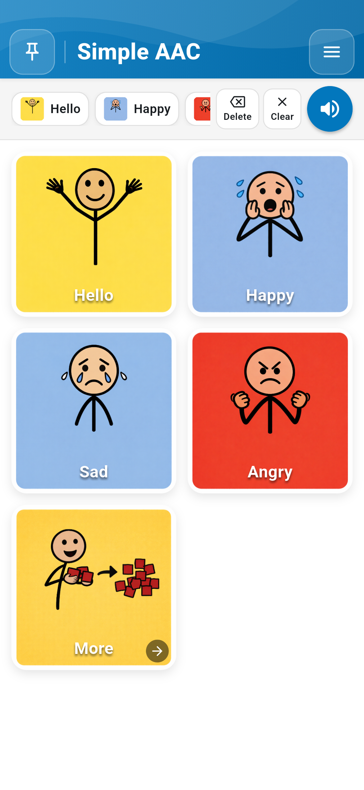
   *Figure 6.4: Text Color Picker featuring a 3-card live preview canvas.*

3. **Board Background Color**: Sets the background canvas of the AAC communication grid.
   
   *Figure 6.5: Board Background Color Picker with real-time multi-card contrast preview.*

### 6.3 Color Vision Support (Color-Blind Safe Mode)
For users with color vision deficiency (protanopia, deuteranopia, tritanopia), Simple AAC provides a certified **Color-Blind Safe Mode** with optimized contrast ratios exceeding WCAG AAA standards.

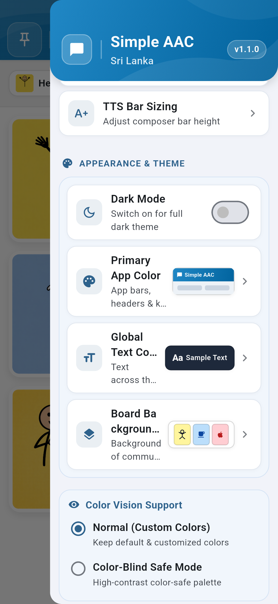
*Figure 6.6: Color Vision Support settings for high-contrast accessibility.*

### 6.4 Haptic Feedback
Enable **Haptic Feedback** in the Settings Drawer to deliver a satisfying tactile response on every card tap, reinforcing cause-and-effect learning.

---

## Chapter 7: Safety, Board Pinning and Child Lock

Accidental taps or intentional exploration can inadvertently delete cards or alter settings. Simple AAC includes a robust PIN protection mechanism.

### 7.1 Activating Board Lock
Tap the **Pin Board** button on the top-left of the application header to lock the board.

*Figure 7.1: Setting up or entering the 4-digit security PIN.*

When locked:
- The Settings Drawer is disabled.
- Edit Mode cannot be accessed.
- Card positions and labels cannot be modified.
- The user can communicate freely without risk of data alteration.

---

## Chapter 8: Data Backup, Restore and Offline Privacy

### 8.1 100% Strict Offline Privacy
Simple AAC operates entirely on the device. No personal photos, recorded voices, or communication logs are transmitted to external servers.

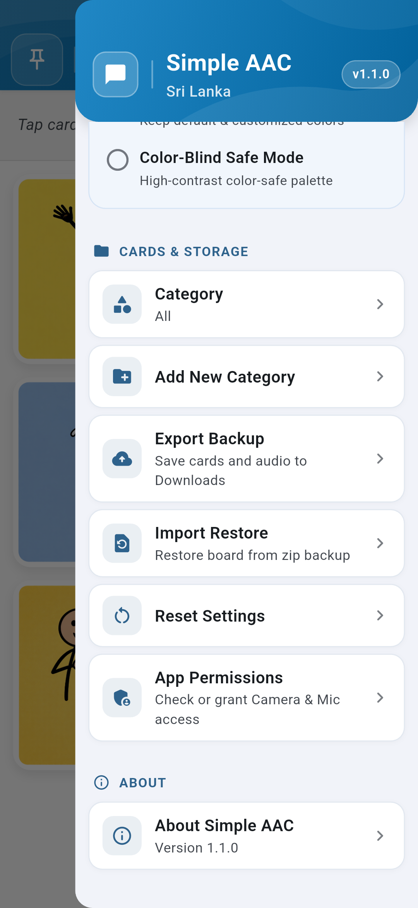
*Figure 8.1: Cards & Storage management section in the Settings Drawer.*

### 8.2 Exporting Backups
1. Open the Settings Drawer and scroll to **CARDS & STORAGE**.
2. Tap **Export Backup**.
3. All custom cards, photos, recorded audio files, and layout preferences are bundled into a portable ZIP archive saved to your device's `Downloads` folder.

### 8.3 Restoring Backups
To migrate to a new device or recover settings:
1. Tap **Import Restore**.
2. Select your previously exported Simple AAC ZIP file.
3. The app safely unpacks and verifies all cards and audio assets, immediately restoring your complete personalized vocabulary.

### 8.4 Offline TTS Configuration
Verify your offline voice models by tapping **Offline Speech** in the drawer:

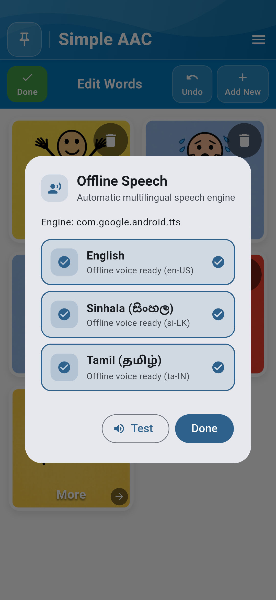
*Figure 8.2: Offline Speech configuration ensuring native English, Sinhala, and Tamil TTS engines are active.*

---

*Simple AAC Sri Lanka — Version 1.1.0 (Release Candidate)*  
*Empowering voices across Sri Lanka with dignity, independence, and reliability.*
