# Simple AAC ශ්‍රී ලංකා — පරිශීලක අත්පොත (v1.1.0)
**දිනපතා සන්නිවේදනය, කාඩ්පත් සැකසීම සහ ප්‍රවේශ්‍යතාව සඳහා වූ සම්පූර්ණ මගපෙන්වීම**

---

## පටුන
1. [1 වන පරිච්ඡේදය: Simple AAC වෙත සාදරයෙන් පිළිගනිමු](#1-වන-පරිච්ඡේදය-simple-aac-වෙත-සාදරයෙන්-පිළිගනිමු)
2. [2 වන පරිච්ඡේදය: කථනය සහ වාක්‍ය සැකසීම](#2-වන-පරිච්ඡේදය-කථනය-සහ-වාක්‍ය-සැකසීම)
3. [3 වන පරිච්ඡේදය: කාඩ්පත් සංස්කරණය සහ භාෂා ත්‍රිත්වය](#3-වන-පරිච්ඡේදය-කාඩ්පත්-සංස්කරණය-සහ-භාෂා-ත්‍රිත්වය)
4. [4 වන පරිච්ඡේදය: චලන රූප (Animated GIFs) සහ වීඩියෝ ලූප](#4-වන-පරිච්ඡේදය-චලන-රූප-animated-gifs-සහ-වීඩියෝ-ලූප)
5. [5 වන පරිච්ඡේදය: කාණ්ඩ (Categories) සහ ෆෝල්ඩර මගින් සංවිධානය කිරීම](#5-වන-පරිච්ඡේදය-කාණ්ඩ-categories-සහ-ෆෝල්ඩර-මගින්-සංවිධානය-කිරීම)
6. [6 වන පරිච්ඡේදය: වර්ණ තේමා, Live Preview සහ ස්පර්ශක කම්පනය (Haptic Feedback)](#6-වන-පරිච්ඡේදය-වර්ණ-තේමා-live-preview-සහ-ස්පර්ශක-කම්පනය-haptic-feedback)
7. [7 වන පරිච්ඡේදය: ළමා ආරක්ෂාව සහ Board Pinning (PIN අගුල)](#7-වන-පරිච්ඡේදය-ළමා-ආරක්ෂාව-සහ-board-pinning-pin-අගුල)
8. [8 වන පරිච්ඡේදය: දත්ත සුරැකීම (Backup), නැවත ලබාගැනීම (Restore) සහ නොබැඳි රහස්‍යතාව](#8-වන-පරිච්ඡේදය-දත්ත-සුරැකීම-backup-නැවත-ලබාගැනීම-restore-සහ-නොබැඳි-රහස්‍යතාව)

---

## 1 වන පරිච්ඡේදය: Simple AAC වෙත සාදරයෙන් පිළිගනිමු

Simple AAC ශ්‍රී ලංකා යනු කථන අපහසුතා ඇති දරුවන්, ඕටිසම් (Autism Spectrum), කථන ප්‍රමාදයන්, ආඝාතය (Stroke) හෝ වෙනත් සන්නිවේදන දුෂ්කරතා සහිත පුද්ගලයන් උදෙසාම විශේෂයෙන් නිර්මාණය කරන ලද විකල්ප සහ වර්ධක සන්නිවේදන (AAC) මෘදුකාංගයකි.

මෙය 100% ක්ම අන්තර්ජාල සම්බන්ධතාවයකින් තොරව (Offline) ක්‍රියාත්මක වන අතර, සිංහල, දෙමළ සහ ඉංග්‍රීසි භාෂා ත්‍රිත්වයෙන්ම ක්ෂණිකව කථා කිරීමේ හැකියාව සලසයි.

### ප්‍රධාන අතුරුමුහුණත (Main Interface)

ඔබ ඇප් එක විවෘත කළ විට, ඇසට පහසු මෙන්ම පැහැදිලි බව උපරිම කරන නිල් පැහැති තේමාවෙන් (Blue Theme) යුතු මුල් තිරය දිස්වේ.

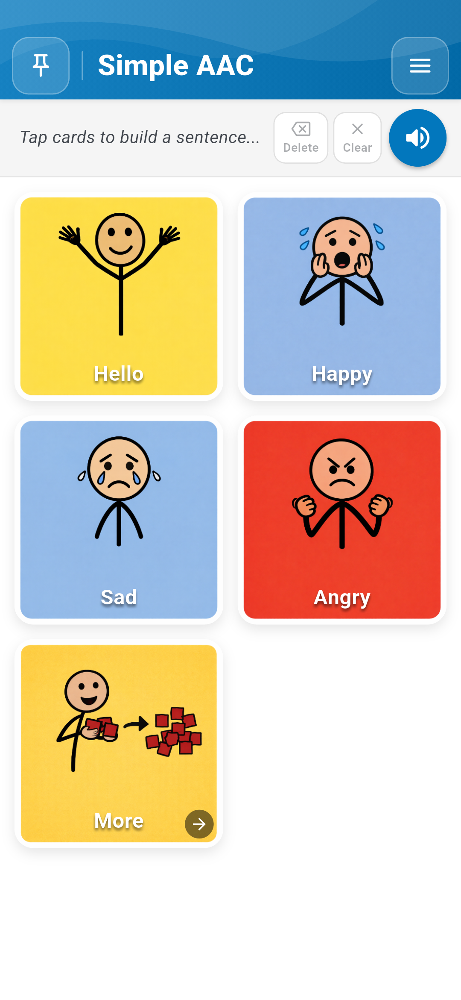
*රූපය 1.1: නිල් පැහැති ශීර්ෂය (Header), වාක්‍ය තීරුව (Sentence Bar) සහ සන්නිවේදන කාඩ්පත් සහිත Simple AAC මුල් තිරය.*

ප්‍රධාන අතුරුමුහුණත කොටස් තුනකින් සමන්විත වේ:
1. **ඉහළ තීරුව (Top Bar)**: වම්පසින් ඇති **Pin Board** (ආරක්ෂිත අගුල), මැදින් ඇති **Simple AAC** නාමය සහ දකුණුපසින් ඇති **Menu (සැකසුම් මෙනුව)**.
2. **වාක්‍ය තීරුව (Sentence Composer Bar)**: තෝරාගත් කාඩ්පත් පෙළගැසෙන සහ එකවර ශ්‍රවණය කළ හැකි ප්‍රදේශය.
3. **කාඩ්පත් ජාලය (AAC Card Grid)**: කුඩා දරුවන්ට සහ ඇඟිලි පාලනය අපහසු අයට පවා පහසුවෙන් ස්පර්ශ කළ හැකි ඉහළ ප්‍රතිවිරෝධතා (High Contrast) සහිත කාඩ්පත්.

*රූපය 1.2: විශ්වීය සංකේත සහ පැහැදිලි අකුරු සහිත සන්නිවේදන කාඩ්පත් ජාලය.*

---

## 2 වන පරිච්ඡේදය: කථනය සහ වාක්‍ය සැකසීම

### 2.1 කාඩ්පතක් ස්පර්ශ කර කථා කිරීම
සන්නිවේදනය ආරම්භ කිරීම ඉතා පහසුය:
- **ක්ෂණික හඬ (Tap to Speak)**: සැකසුම් වල "Tap to Speak" සක්‍රිය කර ඇති විට, ඕනෑම කාඩ්පතක් ස්පර්ශ කළ සැණින් එම කාඩ්පතෙහි නම ශබ්ද නගා කියවනු ලැබේ.
- **ස්පර්ශක සංවේදනය (Haptic Pop)**: කාඩ්පතක් ස්පර්ශ කරන සෑම අවස්ථාවකදීම සුළු කම්පනයක් (Live Vibration) සහ අලංකාර Pop effect එකක් ලැබෙන බැවින්, දරුවාට ක්‍රියාව නිවැරදිව සිදු වූ බව ක්ෂණිකව දැනේ.

*රූපය 2.1: කාඩ්පත් ස්පර්ශ කර වාක්‍ය සාදන සහ හඬින් ප්‍රකාශ වන ආකාරය දැක්වෙන සජීවී ආදර්ශනය.*

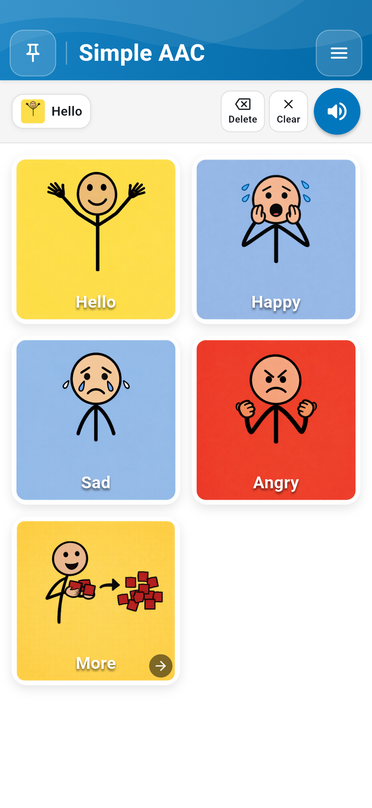
*රූපය 2.2: "Hello" කාඩ්පත ස්පර්ශ කළ විට එය වාක්‍ය තීරුවට එක්වී ශබ්ද නගා කියවෙන ආකාරය.*

### 2.2 සම්පූර්ණ වාක්‍ය ගොඩනැගීම
එකිනෙකට වෙනස් කාඩ්පත් කිහිපයක් අනුපිළිවෙලින් ස්පර්ශ කිරීමෙන් සම්පූර්ණ අදහසක් ප්‍රකාශ කළ හැක.

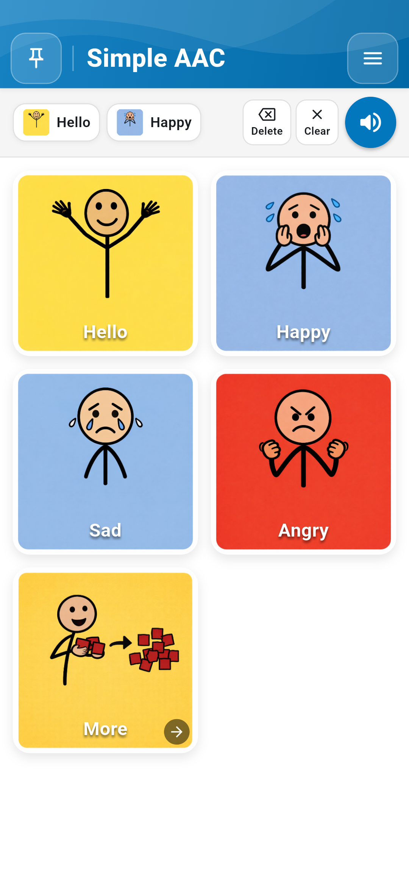
*රූපය 2.3: "Hello" සහ "Happy" එකතු කර වාක්‍යයක් ගොඩනගා ඇති ආකාරය.*

වාක්‍ය තීරුවේ ඇති පාලක:
- **Delete (මකනය)**: අවසානයට එක් කළ කාඩ්පත පමණක් ඉවත් කරයි.
- **Clear (හිස් කිරීම)**: වාක්‍ය තීරුවේ ඇති සියලුම වචන එකවර ඉවත් කරයි.
- **Speak Sentence (ස්පීකර ලකුණ)**: සම්පූර්ණ වාක්‍යයම එකදිගට චතුර ලෙස ශබ්ද නගා කියවයි.

---

## 3 වන පරිච්ඡේදය: කාඩ්පත් සංස්කරණය සහ භාෂා ත්‍රිත්වය

සෑම පුද්ගලයෙකුගේම අවශ්‍යතා වෙනස් වේ. Simple AAC මගින් ඕනෑම කාඩ්පතක් තම අවශ්‍යතාවයට අනුව වෙනස් කරගත හැක.

### 3.1 සංස්කරණ මාදිලිය (Edit Mode) සක්‍රිය කිරීම
1. ඉහළ දකුණු කෙළවරේ ඇති **Menu Button** ස්පර්ශ කරන්න.
2. **Enable Edit Mode** තෝරන්න.
3. පුවරුව සංස්කරණ තත්ත්වයට පත්වන අතර, කාඩ්පත් මත රතු පැහැති Delete ලකුණ සහ ඉහළින් **Add New** බොත්තම දිස්වේ.

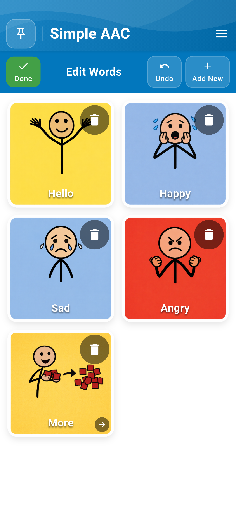
*රූපය 3.1: කාඩ්පත් සංස්කරණ මාදිලිය (Edit Mode) ක්‍රියාත්මකව ඇති ආකාරය.*

### 3.2 කාඩ්පත් සංස්කරණ කවුළුව (Card Editor Dialog)
Edit Mode ක්‍රියාත්මකව තිබියදී ඕනෑම කාඩ්පතක් ස්පර්ශ කිරීමෙන් සංස්කරණ කවුළුව විවෘත වේ.

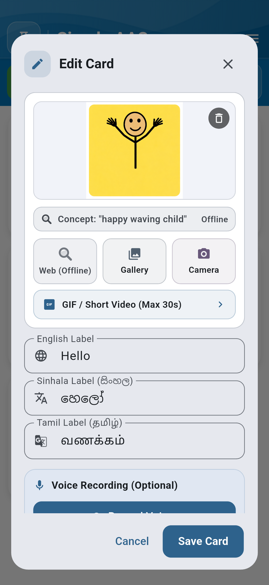
*රූපය 3.2: පින්තූර, භාෂා ත්‍රිත්වයේ නම් සහ හඬ පටිගත කිරීමේ පහසුකම් සහිත සංස්කරණ කවුළුව.*

### 3.3 කැමරාවෙන් සහ ගැලරියෙන් සැබෑ ඡායාරූප එක් කිරීම
- **Camera (කැමරාව)**: දරුවා දිනපතා භාවිත කරන සැබෑ භාණ්ඩ (වතුර බෝතලය, සෙල්ලම් බඩු, පවුලේ සාමාජිකයන්) ඡායාරූප ගෙන කාඩ්පතට ඇතුළත් කළ හැක. (කැමරා අවසර නොමැති නම් ස්වයංක්‍රීයව අවසර විමසයි).
- **Gallery (ගැලරිය)**: දුරකථනයේ ඇති පින්තූර පහසුවෙන් තෝරාගත හැක.

*රූපය 3.3: කැමරාව මගින් සැබෑ ලෝකයේ ද්‍රව්‍ය ඡායාරූපගත කර කාඩ්පත් වලට එක් කිරීම.*

### 3.4 ස්මාර්ට් පින්තූර සෙවීම (Smart Image Search)
දරුවන්ට සුදුසු, ආරක්ෂිත පින්තූර සෙවීම සඳහා Smart Search පහසුකම භාවිතා කළ හැක.

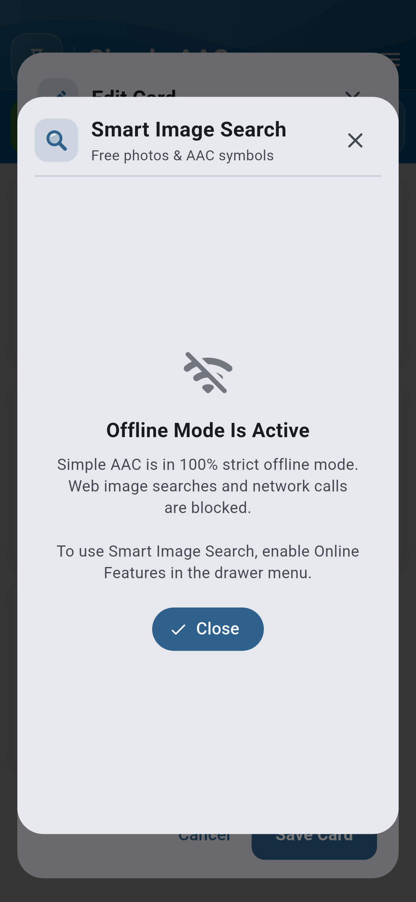
*රූපය 3.4: දරුවන්ට ආරක්ෂිත Smart Image Search සෙවුම් කවුළුව.*

### 3.5 සිංහල, දෙමළ සහ ඉංග්‍රීසි භාෂා ත්‍රිත්වය
ශ්‍රී ලාංකික පරිසරයට ගැලපෙන ලෙස එකම කාඩ්පතට භාෂා තුනෙන්ම නම් ලබාදිය හැක:
- **English Label**: ඉංග්‍රීසි නම (උදා: Hello, Water).
- **Sinhala Label (සිංහල)**: නිවැරදි සිංහල යුනිකෝඩ් නම (උදා: හෙලෝ, වතුර, බඩගිනියි).
- **Tamil Label (தமிழ்)**: නිවැරදි දෙමළ නම (උදා: வணக்கம், தண்ணீர்).

*රූපය 3.5: සිංහල, දෙමළ සහ ඉංග්‍රීසි ලේබල් එකවර කළමනාකරණය කිරීම.*

### 3.6 ඔබේම හඬ පටිගත කිරීම (Custom Voice Recording)
දරුවා වඩාත් කැමති මවගේ, පියාගේ හෝ ගුරුවරයාගේ සැබෑ හඬින්ම කාඩ්පත කථා කිරීමට සැලැස්විය හැක:
1. සංස්කරණ කවුළුවේ ඇති **Record Voice** ස්පර්ශ කරන්න.
2. මයික්‍රෆෝනයට පැහැදිලිව වචනය පවසන්න.
3. **Stop** ඔබා සුරකින්න. ඉන්පසු එම කාඩ්පත ස්පර්ශ කරන සෑම විටම වාදනය වන්නේ එම සැබෑ හඬයි!

*රූපය 3.6: උසස් තත්ත්වයේ හඬ පටිගත කිරීමේ පහසුකම.*

---

## 4 වන පරිච්ඡේදය: චලන රූප (Animated GIFs) සහ වීඩියෝ ලූප

ඕටිසම් සහිත දරුවන්ට ස්ථිතික පින්තූර වලට වඩා යම් ක්‍රියාවක් (උදා: පැනීම, අත් සේදීම, වතුර බීම) සජීවීව දැකීමෙන් වටහා ගැනීම ඉතා පහසුය.

### 4.1 Animated GIFs එක් කිරීම
Simple AAC මගින් බැටරිය වැය නොවන අයුරින් අඛණ්ඩව ලූප (loop) වන සජීවී GIF රූප කාඩ්පත් වලට එක් කළ හැක.

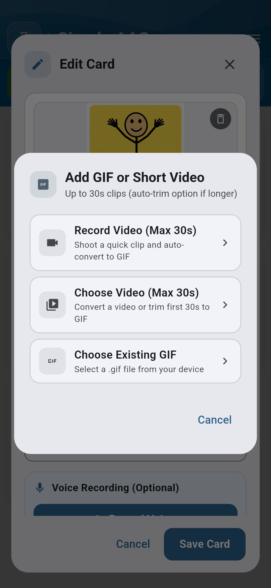
*රූපය 4.1: චලන රූප (GIF) එක් කිරීමේ කවුළුව.*

### 4.2 කෙටි වීඩියෝ GIF බවට පරිවර්තනය කිරීම
තත්පර 30 දක්වා වූ කෙටි වීඩියෝ ක්ලිප් (උදා: සංඥා භාෂාව, චිකිත්සක ක්‍රියාකාරකම්) ඇප් එක තුළදීම ස්වයංක්‍රීයව සුමට GIF එකක් බවට පත් කරගත හැක.

*රූපය 4.2: කෙටි වීඩියෝ සජීවී කාඩ්පත් බවට පත් කිරීමේ මෙවලම.*

---

## 5 වන පරිච්ඡේදය: කාණ්ඩ (Categories) සහ ෆෝල්ඩර මගින් සංවිධානය කිරීම

වචන මාලාව පුළුල් වන විට, ඒවා කාණ්ඩ අනුව (උදා: *හැඟීම්*, *ආහාර සහ බීම*, *පාසල*, *ක්‍රියාකාරකම්*) ෆෝල්ඩර තුළට එක් කළ හැක.

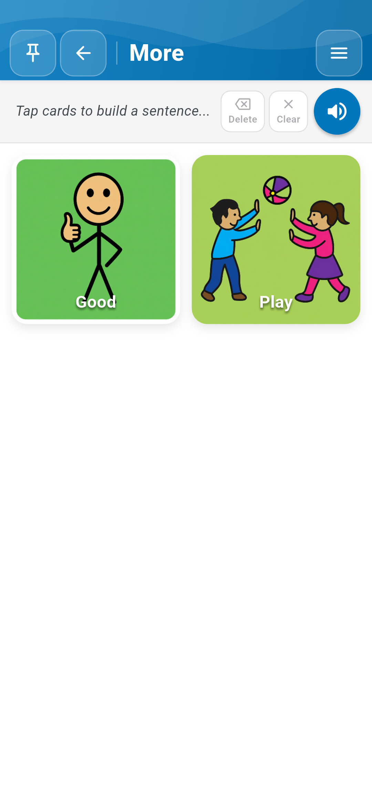
*රූපය 5.1: "More ->" ෆෝල්ඩරය තුළට පිවිස අදාළ වචන කාණ්ඩය වෙත ප්‍රවේශ වීම.*

ෆෝල්ඩරයක් ස්පර්ශ කළ විට එම කාණ්ඩයේ කාඩ්පත් වෙත ගමන් කරන අතර, ඉහළින් ඇති වාක්‍ය තීරුව එලෙසම රඳවා තබා ගනී.

---

## 6 වන පරිච්ඡේදය: වර්ණ තේමා, Live Preview සහ ස්පර්ශක කම්පනය (Haptic Feedback)

### 6.1 සැකසුම් මෙනුව (Settings Drawer)
ඉහළ දකුණුපස ඇති Menu බොත්තමෙන් සැකසුම් මෙනුව විවෘත වේ.

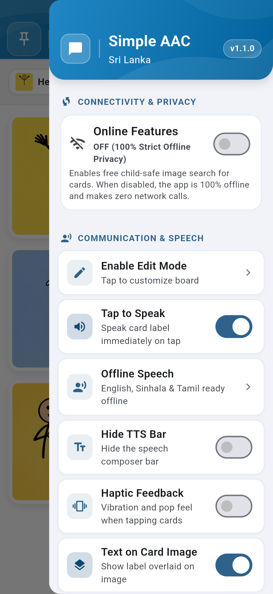
*රූපය 6.1: v1.1.0 අනුවාදය, නොබැඳි තත්ත්වය, සහ Haptic Feedback ස්විචය සහිත සැකසුම් මෙනුව.*

### 6.2 සජීවී පෙරදසුන (Live Preview) සහිත වර්ණ තේරීම
Simple AAC v1.1.0 හි සජීවීව වෙනස්වීම් පෙනෙන අලුත්ම Color Pickers හඳුන්වා දී ඇත:

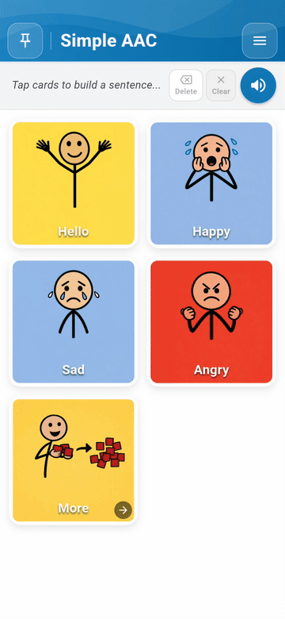
*රූපය 6.2: සැකසුම් මෙනුවෙන් වර්ණ වෙනස් කරන ආකාරය දැක්වෙන සජීවී ආදර්ශනය.*

1. **Primary App Color (ප්‍රධාන ඇප් වර්ණය)**: ඉහළ තීරුව සහ ප්‍රධාන බොත්තම් වල වර්ණය වෙනස් කරයි.
   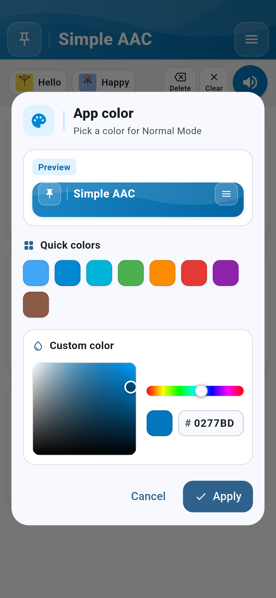
   *රූපය 6.3: කුඩා ශීර්ෂ පෙරදසුනක් සහ සූදානම් කළ වර්ණ සහිත Primary Color Picker.*

2. **Global Text Color (අකුරු වර්ණය)**: පුවරුවේ ඇති සියලුම කාඩ්පත් වල අකුරු වල වර්ණය වෙනස් කරයි.
   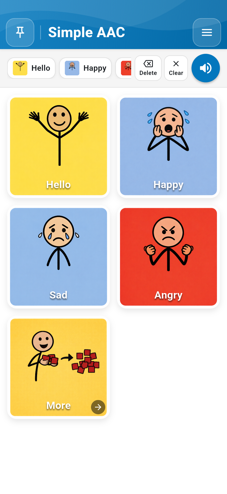
   *රූපය 6.4: කාඩ්පත් 3 ක සජීවී පෙරදසුනක් සහිත Text Color Picker.*

3. **Board Background Color (පසුබිම් වර්ණය)**: කාඩ්පත් පිහිටි පසුබිම් කැන්වසයේ වර්ණය වෙනස් කරයි.
   
   *රූපය 6.5: සැබෑ කාඩ්පත් සමග වෙනස පෙනෙන Board Background Color Picker.*

### 6.3 වර්ණ අන්ධභාවය සඳහා සහාය (Color-Blind Safe Mode)
වර්ණ හඳුනාගැනීමේ අපහසුතා ඇති අය සඳහා WCAG AAA ප්‍රමිතියට අනුකූල ඉහළ ප්‍රතිවිරෝධතා සහිත විශේෂ වර්ණ පද්ධතියක් (Color-Blind Safe Mode) ඇත.

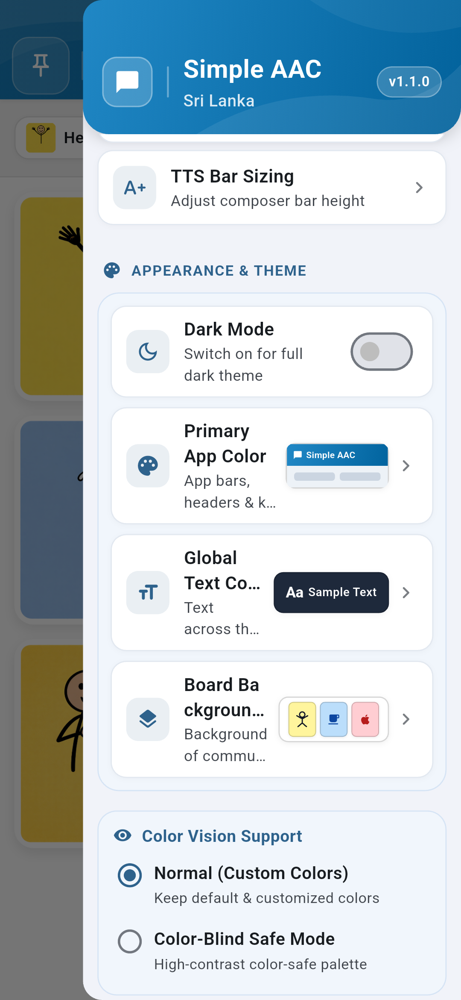
*රූපය 6.6: Color Vision Support ප්‍රවේශ්‍යතා සැකසුම්.*

### 6.4 ස්පර්ශක ප්‍රතිචාරය (Haptic Feedback)
කාඩ්පතක් ස්පර්ශ කරන විට දැනෙන කම්පන සංවේදනය අවශ්‍ය නම් මෙම ස්විචයෙන් සක්‍රිය හෝ අක්‍රිය කරගත හැක (Default ලෙස On කර ඇත).

---

## 7 වන පරිච්ඡේදය: ළමා ආරක්ෂාව සහ Board Pinning (PIN අගුල)

දරුවා අතින් අත්වැරදීමකින් කාඩ්පත් මැකී යාම හෝ සැකසුම් වෙනස් වීම වැළැක්වීම සඳහා PIN අංකයක් මගින් පුවරුව අගුළු දැමිය හැක.

### 7.1 Board Lock සක්‍රිය කිරීම
ඉහළ වම් කෙළවරේ ඇති **Pin Board** බොත්තම ස්පර්ශ කර අංක 4 කින් යුත් රහස්‍ය අංකයක් (PIN) ඇතුළත් කරන්න.

*රූපය 7.1: රහස්‍ය PIN අංකය ඇතුළත් කිරීමේ කවුළුව.*

අගුළු දැමූ පසු:
- Settings Drawer එක විවෘත කළ නොහැක.
- Edit Mode වෙත පිවිසිය නොහැක.
- කාඩ්පත් මැකීම හෝ මාරු කිරීම සිදු කළ නොහැක.
- දරුවාට කිසිදු බියකින් තොරව නිදහසේ සන්නිවේදනය කළ හැක.

---

## 8 වන පරිච්ඡේදය: දත්ත සුරැකීම (Backup), නැවත ලබාගැනීම (Restore) සහ නොබැඳි රහස්‍යතාව

### 8.1 100% නොබැඳි රහස්‍යතාව (Strict Offline Privacy)
ඔබගේ දරුවාගේ ඡායාරූප, පටිගත කළ හඬවල් හෝ සන්නිවේදන තොරතුරු කිසිදු බාහිර සේවාදායකයකට (Server) නොයවන අතර, සියල්ල ඔබගේ දුරකථනය තුළම පමණක් සුරක්ෂිතව පවතී.

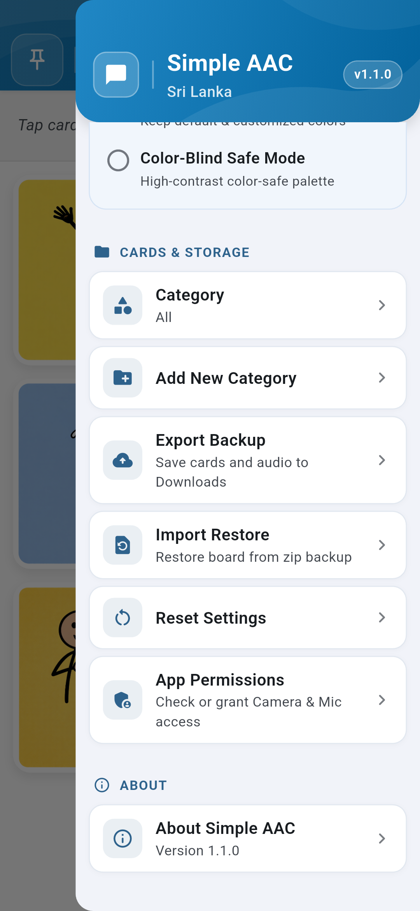
*රූපය 8.1: සැකසුම් මෙනුවේ ඇති Cards & Storage කොටස.*

### 8.2 උපස්ථ පිටපතක් ලබාගැනීම (Export Backup)
1. සැකසුම් මෙනුව විවෘත කර **CARDS & STORAGE** වෙත යන්න.
2. **Export Backup** තෝරන්න.
3. ඔබ සැකසූ සියලුම කාඩ්පත්, ඡායාරූප සහ හඬ පට ZIP ගොනුවක් ලෙස ඔබගේ දුරකථනයේ `Downloads` ෆෝල්ඩරයට ක්ෂණිකව සුරැකේ.

### 8.3 උපස්ථය නැවත ලබාගැනීම (Import Restore)
නව දුරකථනයකට මාරු වන විට හෝ පැරණි දත්ත නැවත ලබාගැනීමට:
1. **Import Restore** තෝරන්න.
2. කලින් සුරකින ලද Simple AAC ZIP ගොනුව තෝරන්න.
3. ඇප් එක මගින් සියලුම කාඩ්පත් සහ ශ්‍රව්‍ය ගොනු නැවත පිහිටුවනු ලබයි.

### 8.4 Offline TTS පරීක්ෂා කිරීම
සිංහල, දෙමළ සහ ඉංග්‍රීසි නොබැඳි කථන එන්ජිම ක්‍රියාත්මක බව සැකසුම් වල **Offline Speech** මගින් පරීක්ෂා කරගත හැක:

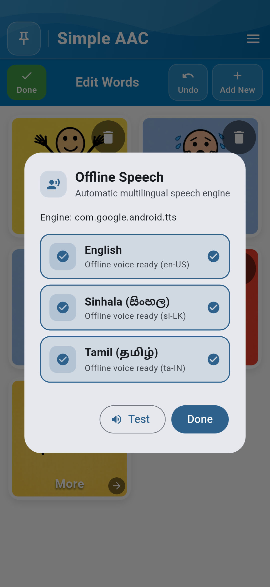
*රූපය 8.2: නොබැඳි කථන (TTS) තත්ත්වය පෙන්වන කවුළුව.*

---

*Simple AAC ශ්‍රී ලංකා — අනුවාදය 1.1.0*  
*ශ්‍රී ලංකාවේ කථන අපහසුතා ඇති දරුවන්ට සහ වැඩිහිටියන්ට ගෞරවනීය, විශ්වාසනීය සහ ස්වාධීන සන්නිවේදන නිදහසක්.*
