# Simple AAC ශ්‍රී ලංකා — සම්පූර්ණ පරිශීලක මාර්ගෝපදේශය (v1.1.0)
**දිනපතා සන්නිවේදනය, කාඩ්පත් සැකසීම සහ ප්‍රවේශ්‍යතාව සඳහා වූ නිල අත්පොත**

---

## පටුන (Table of Contents)

| පරිච්ඡේදය | මාතෘකාව | පිටුව |
| :---: | :--- | :---: |
| **1** | [1 වන පරිච්ඡේදය — Simple AAC භාවිතය ආරම්භ කිරීම](#1-වන-පරිච්ඡේදය--simple-aac-භාවිතය-ආරම්භ-කිරීම) | පිටුව 1 |
| **2** | [2 වන පරිච්ඡේදය — කථනය සහ වාක්‍ය සකස් කිරීම](#2-වන-පරිච්ඡේදය--කථනය-සහ-වාක්‍ය-සකස්-කිරීම) | පිටුව 2 |
| **3** | [3 වන පරිච්ඡේදය — කාඩ්පත් සැකසීම සහ භාෂා ත්‍රිත්වය](#3-වන-පරිච්ඡේදය--කාඩ්පත්-සැකසීම-සහ-භාෂා-ත්‍රිත්වය) | පිටුව 3 |
| **4** | [4 වන පරිච්ඡේදය — චලන රූප (GIF) සහ වීඩියෝ ලූප](#4-වන-පරිච්ඡේදය--චලන-රූප-gif-සහ-වීඩියෝ-ලූප) | පිටුව 4 |
| **5** | [5 වන පරිච්ඡේදය — කාණ්ඩ (Categories) සහ ෆෝල්ඩර මගින් සංවිධානය කිරීම](#5-වන-පරිච්ඡේදය--කාණ්ඩ-categories-සහ-ෆෝල්ඩර-මගින්-සංවිධානය-කිරීම) | පිටුව 5 |
| **6** | [6 වන පරිච්ඡේදය — පෙනුම, වර්ණ තේමා සහ ස්පර්ශක ප්‍රතිචාරය (Haptics)](#6-වන-පරිච්ඡේදය--පෙනුම-වර්ණ-තේමා-සහ-ස්පර්ශක-ප්‍රතිචාරය-haptics) | පිටුව 5 |
| **7** | [7 වන පරිච්ඡේදය — පුවරුව අගුළු දැමීම සහ ළමා ආරක්ෂාව](#7-වන-පරිච්ඡේදය--පුවරුව-අගුළු-දැමීම-සහ-ළමා-ආරක්ෂාව) | පිටුව 7 |
| **8** | [8 වන පරිච්ඡේදය — දත්ත උපස්ථ කිරීම (Backup), නැවත ලබාගැනීම (Restore) සහ නොබැඳි රහස්‍යතාව](#8-වන-පරිච්ඡේදය--දත්ත-උපස්ථ-කිරීම-backup-නැවත-ලබාගැනීම-restore-සහ-නොබැඳි-රහස්‍යතාව) | පිටුව 7 |

---

## 1 වන පරිච්ඡේදය — Simple AAC භාවිතය ආරම්භ කිරීම

**Simple AAC ශ්‍රී ලංකා** යනු කථන අපහසුතා ඇති දරුවන්, ඕටිසම් (Autism Spectrum), කථන ප්‍රමාදයන්, ආඝාතය (Stroke) හෝ වෙනත් සන්නිවේදන දුෂ්කරතා සහිත පුද්ගලයන් උදෙසාම විශේෂයෙන් නිර්මාණය කරන ලද විකල්ප සහ වර්ධක සන්නිවේදන (AAC) මෘදුකාංගයකි. මෙය 100% ක්ම අන්තර්ජාල සම්බන්ධතාවයකින් තොරව (Offline) ක්‍රියාත්මක වන අතර, **සිංහල, දෙමළ සහ ඉංග්‍රීසි** භාෂා ත්‍රිත්වයෙන්ම ක්ෂණිකව කථා කිරීමේ හැකියාව සලසයි.

### 1.1 ප්‍රධාන තිරය හඳුනා ගැනීම

ඔබ ඇප් එක විවෘත කළ විට, ඇසට පහසු මෙන්ම පැහැදිලි බව උපරිම කරන නිල් පැහැති තේමාවෙන් (Blue Theme) යුතු මුල් තිරය දිස්වේ. ප්‍රධාන අතුරුමුහුණත කොටස් තුනකින් සමන්විත වේ:

1. **ඉහළ තීරුව (Top Bar):** වම්පසින් ඇති **Pin Board** (ආරක්ෂිත අගුල), මැදින් ඇති **Simple AAC** නාමය සහ දකුණුපසින් ඇති **Menu (සැකසුම් මෙනුව)**.
2. **වාක්‍ය තීරුව (Sentence Composer Bar):** තෝරාගත් කාඩ්පත් පෙළගැසෙන සහ එකවර ශ්‍රවණය කළ හැකි ප්‍රදේශය.
3. **කාඩ්පත් ජාලය (AAC Card Grid):** කුඩා දරුවන්ට සහ ඇඟිලි පාලනය අපහසු අයට පවා පහසුවෙන් ස්පර්ශ කළ හැකි ඉහළ ප්‍රතිවිරෝධතා (High Contrast) සහිත කාඩ්පත්.

| 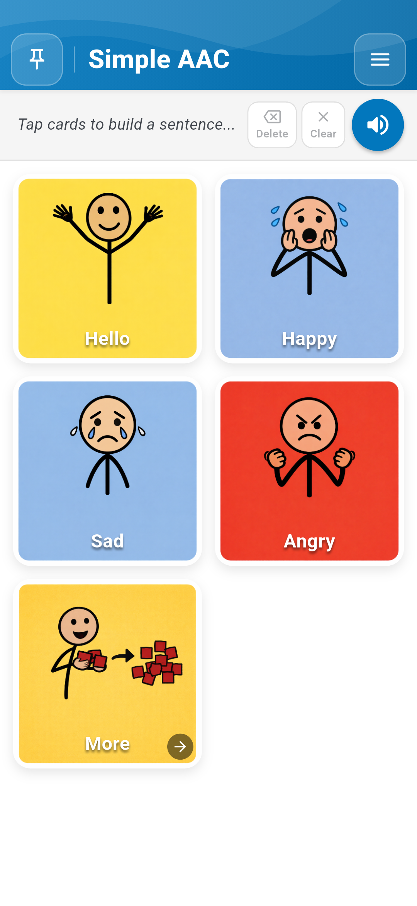 |  |
| :---: | :---: |
| *රූපය 1.1: නිල් පැහැති ශීර්ෂය, වාක්‍ය තීරුව සහ කාඩ්පත් සහිත මුල් තිරය* | *රූපය 1.2: විශ්වීය සංකේත සහ පැහැදිලි අකුරු සහිත කාඩ්පත් ජාලය* |

---

## 2 වන පරිච්ඡේදය — කථනය සහ වාක්‍ය සකස් කිරීම

### 2.1 කාඩ්පතක් ස්පර්ශ කර කථා කිරීම (Tap to Speak)

සන්නිවේදනය ආරම්භ කිරීම ඉතා පහසුය. Simple AAC ක්ෂණික බහු-සංවේදී ප්‍රතිචාර ලබාදෙයි:

- **ක්ෂණික හඬ (Tap to Speak):** සැකසුම් වල "Tap to Speak" සක්‍රිය කර ඇති විට, ඕනෑම කාඩ්පතක් ස්පර්ශ කළ සැණින් එම කාඩ්පතෙහි නම නොබැඳි TTS හෝ පටිගත කළ හඬින් ශබ්ද නගා කියවනු ලැබේ.
- **ස්පර්ශක සංවේදනය (Haptic Pop):** කාඩ්පතක් ස්පර්ශ කරන සෑම අවස්ථාවකදීම සුළු කම්පනයක් (Live Vibration) සහ අලංකාර Pop effect එකක් ලැබෙන බැවින්, දරුවාට ක්‍රියාව නිවැරදිව සිදු වූ බව ක්ෂණිකව දැනේ.

|  | 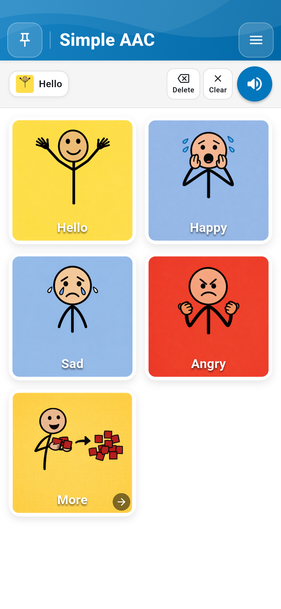 |
| :---: | :---: |
| *රූපය 2.1: කාඩ්පත් ස්පර්ශ කර වාක්‍ය සාදන ආකාරය* | *රූපය 2.2: "Hello" කාඩ්පත වාක්‍ය තීරුවට එක්වීම* |

### 2.2 සම්පූර්ණ වාක්‍ය ගොඩනැගීම (Sentence Composer)

එකිනෙකට වෙනස් කාඩ්පත් කිහිපයක් අනුපිළිවෙලින් ස්පර්ශ කිරීමෙන් සම්පූර්ණ අදහසක් ප්‍රකාශ කළ හැක (උදා: *"Hello"* + *"Happy"*). වාක්‍ය තීරුවේ ඇති පාලක:

- **Delete (මකනය):** අවසානයට එක් කළ කාඩ්පත පමණක් ඉවත් කරයි.
- **Clear (හිස් කිරීම):** වාක්‍ය තීරුවේ ඇති සියලුම වචන එකවර ඉවත් කරයි.
- **Speak Sentence (ස්පීකර ලකුණ):** සම්පූර්ණ වාක්‍යයම එකදිගට චතුර ලෙස ශබ්ද නගා කියවයි.

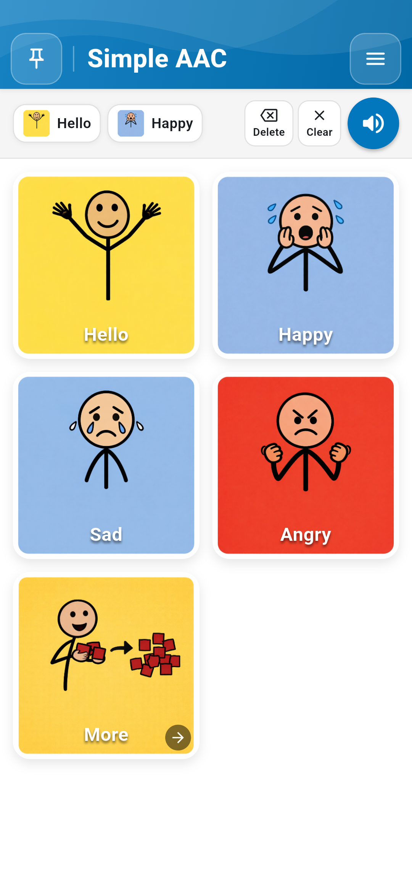  
*රූපය 2.3: "Hello" සහ "Happy" එකතු කර වාක්‍යයක් ගොඩනගා ඇති ආකාරය*

---

## 3 වන පරිච්ඡේදය — කාඩ්පත් සැකසීම සහ භාෂා ත්‍රිත්වය

සෑම පුද්ගලයෙකුගේම අවශ්‍යතා වෙනස් වේ. Simple AAC මගින් ඕනෑම කාඩ්පතක් තම අවශ්‍යතාවයට අනුව වෙනස් කරගත හැක.

### 3.1 Edit Mode සහ Card Editor වෙත පිවිසීම

කාඩ්පත් වෙනස් කිරීමට ඉහළ දකුණුපස **Menu** &rarr; **Enable Edit Mode** තෝරන්න. කාඩ්පත් මත රතු Delete ලකුණ සහ ඉහළින් **Add New** බොත්තම දිස්වේ. ඕනෑම කාඩ්පතක් ස්පර්ශ කිරීමෙන් සංස්කරණ කවුළුව (Card Editor) විවෘත වේ.

| 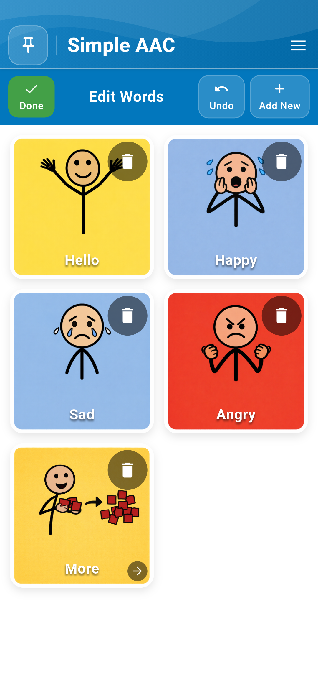 | 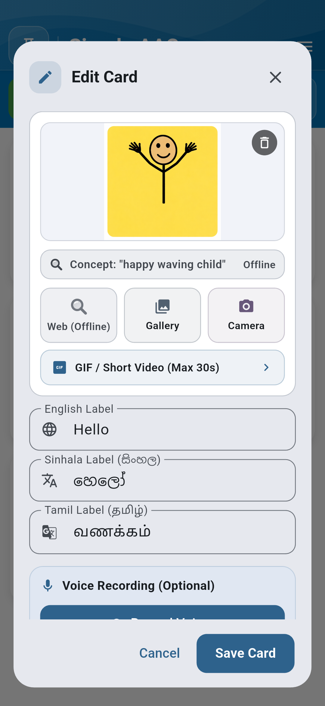 |
| :---: | :---: |
| *රූපය 3.1: කාඩ්පත් සංස්කරණ මාදිලිය (Edit Mode)* | *රූපය 3.2: කාඩ්පත් සංස්කරණ කවුළුව (Card Editor)* |

### 3.2 කැමරාවෙන් සහ Gallery මගින් සැබෑ ඡායාරූප එක් කිරීම

- **Camera (කැමරාව):** දරුවා භාවිත කරන සැබෑ භාණ්ඩ (වතුර බෝතලය, සෙල්ලම් බඩු, පවුලේ අය) ඡායාරූප ගෙන කාඩ්පතට ඇතුළත් කළ හැක.
- **Gallery (ගැලරිය):** දුරකථනයේ ඇති පින්තූර පහසුවෙන් තෝරාගත හැක.
- **Smart Image Search:** දරුවන්ට සුදුසු ආරක්ෂිත පින්තූර සෙවීමේ පහසුකම (Online Features On කර ඇති විට).

|  | 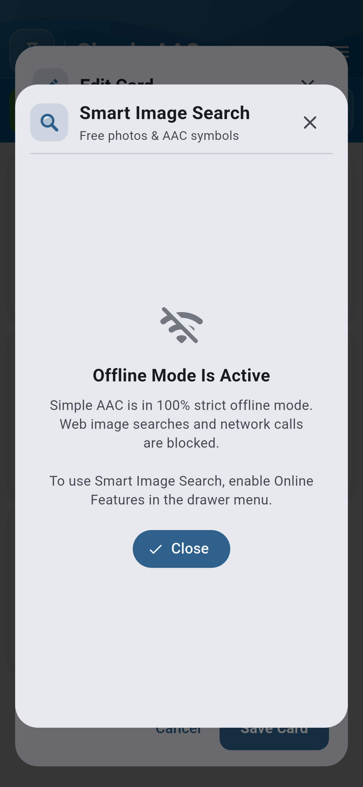 |
| :---: | :---: |
| *රූපය 3.3: කැමරාව මගින් සැබෑ ද්‍රව්‍ය ඡායාරූපගත කිරීම* | *රූපය 3.4: දරුවන්ට ආරක්ෂිත Smart Image Search* |

### 3.3 භාෂා ත්‍රිත්වය (සිංහල, දෙමළ, ඉංග්‍රීසි) සහ සැබෑ හඬ පටිගත කිරීම

ශ්‍රී ලාංකික පරිසරයට ගැලපෙන ලෙස එකම කාඩ්පතට භාෂා තුනෙන්ම නම් ලබාදිය හැක: **English** (Hello), **Sinhala** (හෙලෝ, සතුටුයි, වතුර), සහ **Tamil** (வணக்கம், மகிழ்ச்சி, தண்ணீர்). දරුවා වඩාත් කැමති මවගේ හෝ ගුරුවරයාගේ සැබෑ හඬින්ම කාඩ්පත කථා කිරීමට **Record Voice** මගින් හඬ පටිගත කරගත හැක.

|  |  |
| :---: | :---: |
| *රූපය 3.5: සිංහල, දෙමළ සහ ඉංග්‍රීසි ලේබල් කළමනාකරණය* | *රූපය 3.6: උසස් තත්ත්වයේ සැබෑ හඬ පටිගත කිරීම* |

---

## 4 වන පරිච්ඡේදය — චලන රූප (GIF) සහ වීඩියෝ ලූප

ඕටිසම් සහිත දරුවන්ට ස්ථිතික පින්තූර වලට වඩා යම් ක්‍රියාවක් (උදා: *පැනීම*, *වතුර බීම*, හෝ *අත් සේදීම*) සජීවීව දැකීමෙන් වටහා ගැනීම ඉතා පහසුය. Simple AAC මගින් බැටරිය වැය නොවන අයුරින් අඛණ්ඩව ලූප වන සජීවී GIF රූප කාඩ්පත් වලට එක් කළ හැක.

| 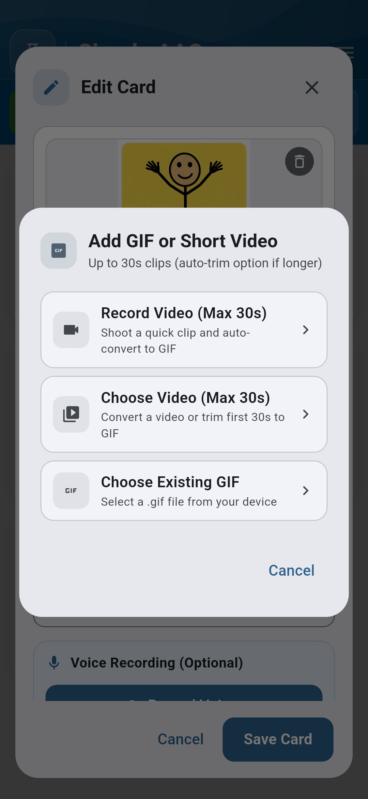 |  |
| :---: | :---: |
| *රූපය 4.1: චලන රූප (GIF) එක් කිරීමේ කවුළුව* | *රූපය 4.2: කෙටි වීඩියෝ සජීවී කාඩ්පත් බවට පත් කිරීම* |

තත්පර 30 දක්වා වූ කෙටි වීඩියෝ ක්ලිප් (උදා: සංඥා භාෂාව, චිකිත්සක ක්‍රියාකාරකම්) ඇප් එක තුළදීම ස්වයංක්‍රීයව සුමට GIF එකක් බවට පත් කරගත හැක.

---

## 5 වන පරිච්ඡේදය — කාණ්ඩ (Categories) සහ ෆෝල්ඩර මගින් සංවිධානය කිරීම

වචන මාලාව පුළුල් වන විට, ඒවා කාණ්ඩ අනුව (උදා: *හැඟීම්*, *ආහාර සහ බීම*, *පාසල*, *ක්‍රියාකාරකම්*) ෆෝල්ඩර තුළට එක් කළ හැක. ෆෝල්ඩරයක් ස්පර්ශ කළ විට එම කාණ්ඩයේ කාඩ්පත් වෙත ගමන් කරන අතර, ඉහළින් ඇති වාක්‍ය තීරුව එලෙසම රඳවා තබා ගනී.

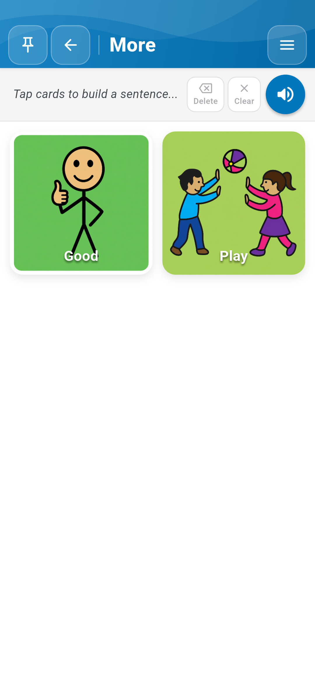  
*රූපය 5.1: "More ->" ෆෝල්ඩරය තුළට පිවිස අදාළ වචන කාණ්ඩය වෙත ප්‍රවේශ වීම*

---

## 6 වන පරිච්ඡේදය — පෙනුම, වර්ණ තේමා සහ ස්පර්ශක ප්‍රතිචාරය (Haptics)

### 6.1 Settings Drawer සහ Live Color Preview

ඉහළ දකුණුපස ඇති Menu බොත්තමෙන් සැකසුම් මෙනුව විවෘත වේ. Simple AAC v1.1.0 හි සජීවීව වෙනස්වීම් පෙනෙන අලුත්ම Color Pickers හඳුන්වා දී ඇත:

| 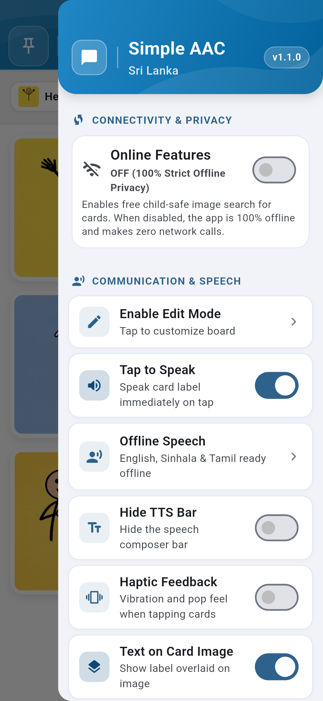 | 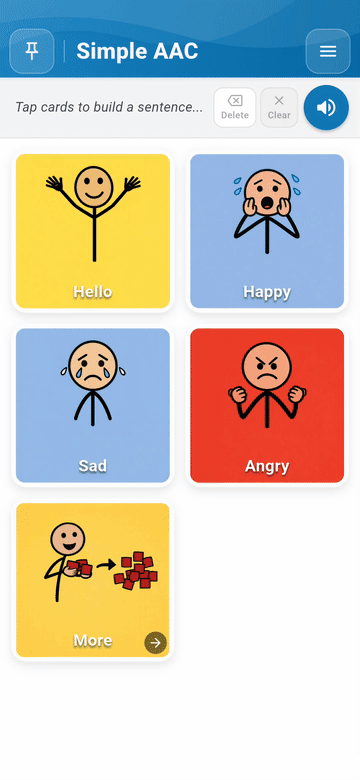 |
| :---: | :---: |
| *රූපය 6.1: v1.1.0 සහ Haptics ස්විචය සහිත මෙනුව* | *රූපය 6.2: වර්ණ වෙනස් කරන සජීවී ආදර්ශනය* |

### 6.2 අලුත්ම Color Pickers මගින් වර්ණ තේරීම

| 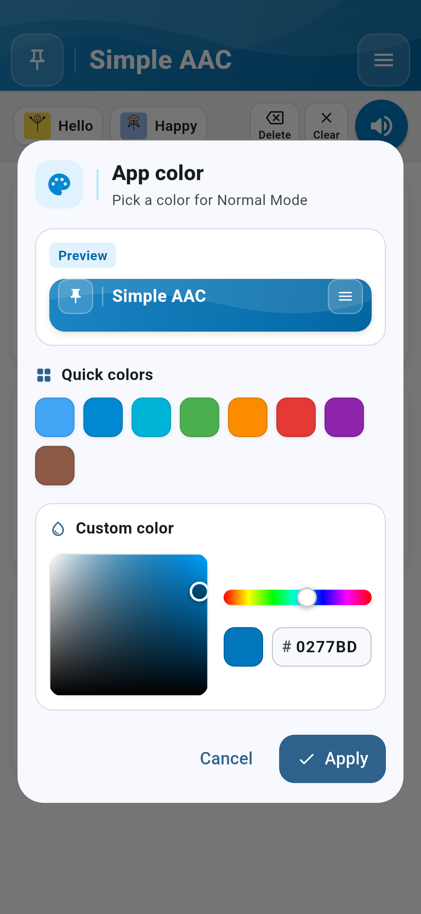 | 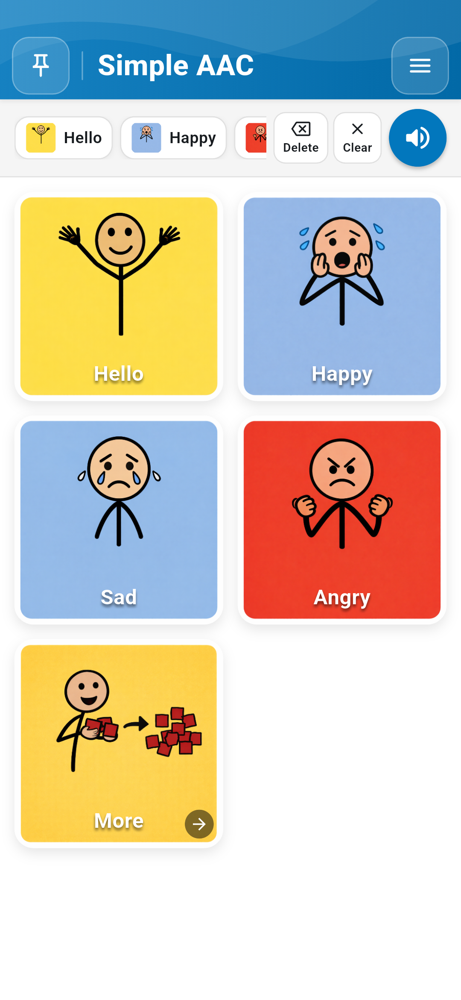 |  |
| :---: | :---: | :---: |
| *රූපය 6.3: ප්‍රධාන ඇප් වර්ණ තේරීම* | *රූපය 6.4: අකුරු වල වර්ණ තේරීම* | *රූපය 6.5: පසුබිම් කැන්වස් වර්ණ තේරීම* |

### 6.3 වර්ණ අන්ධභාවය සඳහා සහාය (Color-Blind Mode) සහ Haptic Feedback

වර්ණ හඳුනාගැනීමේ අපහසුතා ඇති අය සඳහා WCAG AA 4.5:1 ප්‍රමිතියට අනුකූල ඉහළ ප්‍රතිවිරෝධතා සහිත විශේෂ වර්ණ පද්ධතියක් (Color-Blind Safe Mode) සහ ස්පර්ශක ප්‍රතිචාරය (Haptic Feedback) සැකසුම් මෙනුවෙන් සක්‍රිය කරගත හැක.

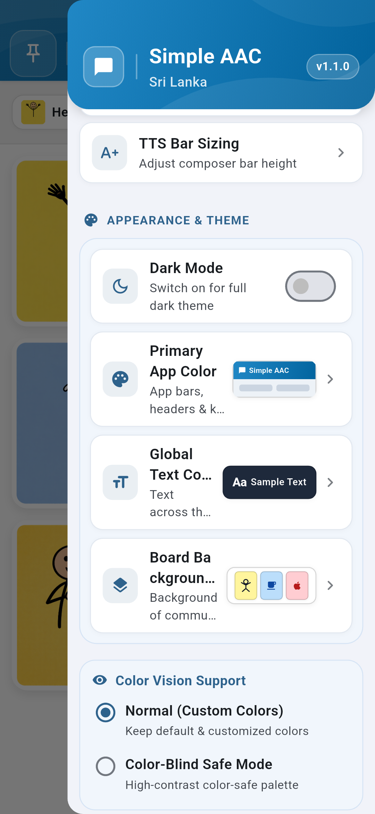  
*රූපය 6.6: Color Vision Support ප්‍රවේශ්‍යතා සැකසුම්*

---

## 7 වන පරිච්ඡේදය — පුවරුව අගුළු දැමීම සහ ළමා ආරක්ෂාව

### 7.1 PIN අංකයක් මගින් Board Pinning සක්‍රිය කිරීම

දරුවා අතින් අත්වැරදීමකින් කාඩ්පත් මැකී යාම හෝ සැකසුම් වෙනස් වීම වැළැක්වීම සඳහා ඉහළ වම් කෙළවරේ ඇති **Pin Board** බොත්තම ස්පර්ශ කර අංක 4 කින් යුත් රහස්‍ය අංකයක් (PIN) ඇතුළත් කළ හැක. අගුළු දැමූ පසු සැකසුම් මෙනුව සහ Edit Mode අක්‍රිය වන අතර, දරුවාට බියකින් තොරව නිදහසේ සන්නිවේදනය කළ හැක.

|  |  |
| :---: | :---: |
| *රූපය 7.1: රහස්‍ය PIN අංකය ඇතුළත් කිරීමේ කවුළුව* | *රූපය 7.2: පුවරුව අගුළු දමා සුරක්ෂිත කර ඇති ආකාරය* |

---

## 8 වන පරිච්ඡේදය — දත්ත උපස්ථ කිරීම (Backup), නැවත ලබාගැනීම (Restore) සහ නොබැඳි රහස්‍යතාව

### 8.1 100% නොබැඳි රහස්‍යතාව (Strict Offline Privacy)

ඔබගේ දරුවාගේ ඡායාරූප, පටිගත කළ හඬවල් හෝ සන්නිවේදන තොරතුරු කිසිදු බාහිර සේවාදායකයකට (Server) නොයවන අතර, සියල්ල ඔබගේ දුරකථනය තුළම පමණක් සුරක්ෂිතව පවතී.

### 8.2 Backups ලබාගැනීම (Export) සහ නැවත පිහිටුවීම (Import Restore)

- **Export Backup:** ඔබ සැකසූ සියලුම කාඩ්පත්, ඡායාරූප සහ හඬ පට ZIP ගොනුවක් ලෙස ඔබගේ දුරකථනයේ `Downloads` ෆෝල්ඩරයට ක්ෂණිකව සුරැකේ.
- **Import Restore:** නව දුරකථනයකට මාරු වන විට කලින් සුරකින ලද Simple AAC ZIP ගොනුව තෝරා සියලුම කාඩ්පත් නැවත ලබාගත හැක.

| 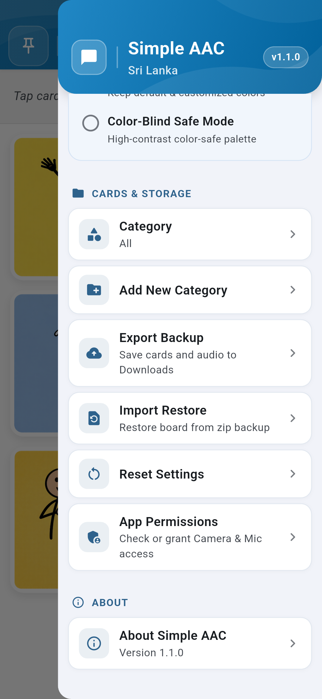 | 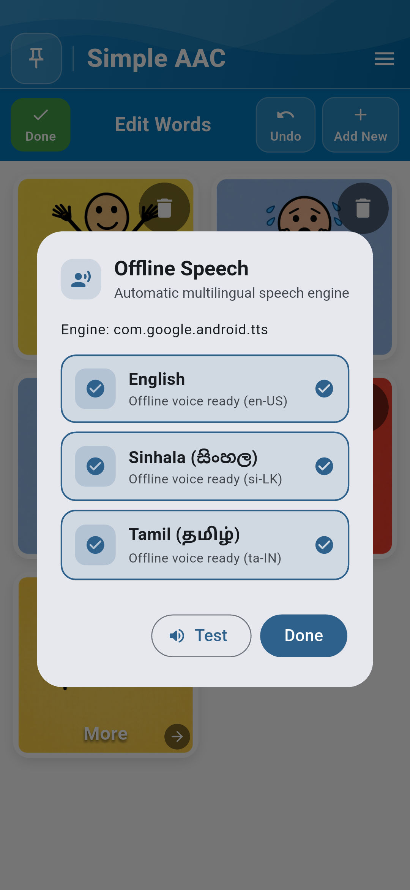 |
| :---: | :---: |
| *රූපය 8.1: සැකසුම් මෙනුවේ ඇති Cards & Storage කොටස* | *රූපය 8.2: නොබැඳි කථන (TTS) තත්ත්වය පෙන්වන කවුළුව* |

> **දත්ත සුරක්ෂිතතාව පිළිබඳ සටහන:** Simple AAC සතුව ස්වයංක්‍රීය `.bak` ගොනු සුරැකීමේ තාක්ෂණයක් (Atomic Persistence) ඇති අතර, කාඩ්පත් 1,000+ දක්වා වූ විශාල දත්ත එකතු පවා කිසිදු දත්ත හානියකින් තොරව සුරක්ෂිතව තබාගත හැක.

---

*Simple AAC ශ්‍රී ලංකා &bull; අනුවාදය 1.1.0 &bull; ශ්‍රී ලාංකික දරුවන්ට සහ වැඩිහිටියන්ට ගෞරවනීය සන්නිවේදන නිදහසක්.*
