# Simple AAC இலங்கை — முழுமையான பயனர் வழிகாட்டி (v1.1.0)
**அன்றாட தொடர்பாடல், அட்டைகளைத் தனிப்பயனாக்குதல் மற்றும் அணுகல்தன்மைக்கான அதிகாரப்பூர்வ கையேடு**

---

## பொருளடக்கம் (Table of Contents)

| அத்தியாயம் | தலைப்பு | பக்கம் |
| :---: | :--- | :---: |
| **1** | [அத்தியாயம் 1 — Simple AAC பயன்படுத்தத் தொடங்குதல்](#அத்தியாயம்-1--simple-aac-பயன்படுத்தத்-தொடங்குதல்) | பக்கம் 1 |
| **2** | [அத்தியாயம் 2 — பேசுதல் மற்றும் வாக்கியம் அமைத்தல்](#அத்தியாயம்-2--பேசுதல்-மற்றும்-வாக்கியம்-அமைத்தல்) | பக்கம் 2 |
| **3** | [அத்தியாயம் 3 — அட்டைகளைத் தனிப்பயனாக்குதல் மற்றும் மும்மொழி ஆதரவு](#அத்தியாயம்-3--அட்டைகளைத்-தனிப்பயனாக்குதல்-மற்றும்-மும்மொழி-ஆதரவு) | பக்கம் 3 |
| **4** | [அத்தியாயம் 4 — இயங்குபடங்கள் (GIFs) மற்றும் வீடியோ லூப்கள்](#அத்தியாயம்-4--இயங்குபடங்கள்-gifs-மற்றும்-வீடியோ-லூப்கள்) | பக்கம் 4 |
| **5** | [அத்தியாயம் 5 — கோப்புறைகள் மற்றும் பிரிவுகளாக ஒழுங்கமைத்தல்](#அத்தியாயம்-5--கோப்புறைகள்-மற்றும்-பிரிவுகளாக-ஒழுங்கமைத்தல்) | பக்கம் 5 |
| **6** | [அத்தியாயம் 6 — தோற்றம், நிறக் கருப்பொருள்கள் மற்றும் தொடு அதிர்வு (Haptic Feedback)](#அத்தியாயம்-6--தோற்றம்-நிறக்-கருப்பொருள்கள்-மற்றும்-தொடு-அதிர்வு-haptic-feedback) | பக்கம் 5 |
| **7** | [அத்தியாயம் 7 — பாதுகாப்பு, பலகைப் பூட்டு மற்றும் குழந்தைகள் பூட்டு](#அத்தியாயம்-7--பாதுகாப்பு-பலகைப்-பூட்டு-மற்றும்-குழந்தைகள்-பூட்டு) | பக்கம் 7 |
| **8** | [அத்தியாயம் 8 — தரவு காப்புப்பிரதி (Backup), மீட்டமைத்தல் (Restore) மற்றும் ஆஃப்லைன் தனியுரிமை](#அத்தியாயம்-8--தரவு-காப்புப்பிரதி-backup-மீட்டமைத்தல்-restore-மற்றும்-ஆஃப்லைன்-தனியுரிமை) | பக்கம் 7 |

---

## அத்தியாயம் 1 — Simple AAC பயன்படுத்தத் தொடங்குதல்

**Simple AAC இலங்கை** என்பது வாய்மொழி பேச முடியாத குழந்தைகள், ஆட்டிசம் (Autism Spectrum), பேச்சுத் தாமதம், அஃபாசியா (Aphasia) அல்லது பக்கவாதத்தால் பாதிக்கப்பட்ட நபர்களுக்காக பிரத்யேகமாக உருவாக்கப்பட்ட ஒரு மாற்று மற்றும் மேம்படுத்தப்பட்ட தொடர்பாடல் (AAC) தளமாகும். இது முற்றிலும் இணைய இணைப்பு இன்றியே (100% Offline) இயங்கக்கூடியதுடன், **தமிழ், சிங்களம் மற்றும் ஆங்கிலம்** ஆகிய மூன்று மொழிகளிலும் உடனடியாகப் பேசும் வசதியை வழங்குகிறது.

### 1.1 முதன்மைத் திரையின் அறிமுகம்

பயன்பாட்டைத் திறக்கும் போது, கண்களுக்கு இனிமையான மற்றும் தெளிவான இயல்புநிலை நீல நிறத் தோற்றம் (Blue Theme) தோன்றும். முதன்மைத் திரை மூன்று முக்கிய பகுதிகளாகப் பிரிக்கப்பட்டுள்ளது:

1. **மேல் பயன்பாட்டுப் பட்டை (Top Application Bar):** இடதுபுறத்தில் **Pin Board** (பாதுகாப்புப் பூட்டு), நடுவில் **Simple AAC** தலைப்பு, மற்றும் வலதுபுறத்தில் **Menu (Drawer)** பொத்தான்.
2. **வாக்கிய அமைப்புப் பட்டை (Sentence Composer Bar):** தெரிவு செய்யப்பட்ட அட்டைகள் வரிசையாகத் தோன்றி, உடனடியாகப் பேசும் மற்றும் திருத்தும் வசதிகளைக் (Delete, Clear, Speak) கொண்டுள்ளது.
3. **AAC அட்டை கட்டம் (AAC Card Grid):** கை விரல் இயக்கம் சவாலானவர்களுக்கும் எளிதாகத் தொடும் வகையில் அமைக்கப்பட்ட உயர் மாறுபட்ட (High Contrast) காட்சி அட்டைகள்.

| 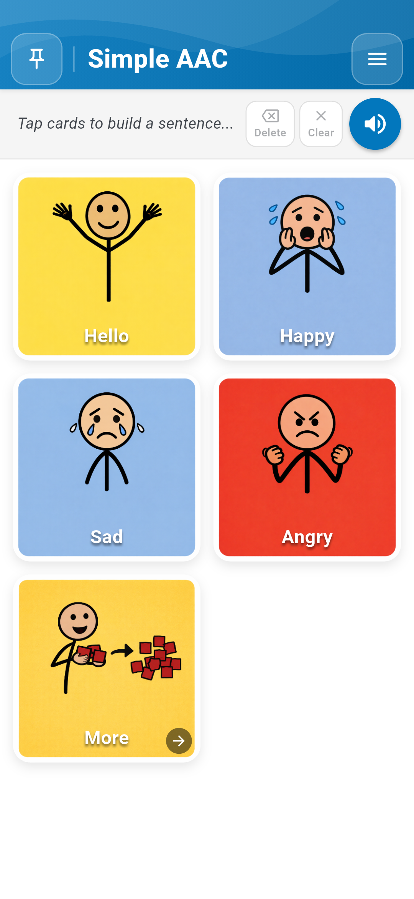 |  |
| :---: | :---: |
| *படம் 1.1: நீல நிற தலைப்பு, வாக்கியப் பட்டை மற்றும் அட்டைகள் கொண்ட முதன்மைத் திரை* | *படம் 1.2: உலகளாவிய குறியீடுகள் மற்றும் தெளிவான எழுத்துக்கள் கொண்ட AAC அட்டைகள்* |

---

## அத்தியாயம் 2 — பேசுதல் மற்றும் வாக்கியம் அமைத்தல்

### 2.1 தொட்டதும் பேசுதல் (Tap to Speak)

தொடர்பாடலைத் தொடங்குவது மிகவும் எளிது. Simple AAC உடனடி பல-உணர்வுப் பின்னூட்டத்தை (Multi-sensory feedback) வழங்குகிறது:

- **உடனடிப் பேச்சு (Instant Speech):** அமைப்புகளில் "Tap to Speak" இயக்கப்பட்டிருக்கும் போது, ஏதேனும் ஓர் அட்டையைத் தொட்டவுடன் அதன் பெயர் ஆஃப்லைன் TTS அல்லது பதிவு செய்யப்பட்ட சொந்தக் குரல் மூலம் உடனடியாகப் பேசப்படும்.
- **தொடு அதிர்வு (Haptic Pop):** ஓர் அட்டையைத் தொடும் போது மெல்லிய அதிர்வு (Haptic feedback) மற்றும் சிறிய காட்சி அசைவு தோன்றி, தெரிவு செய்யப்பட்டதை உறுதிப்படுத்தும்.

|  | 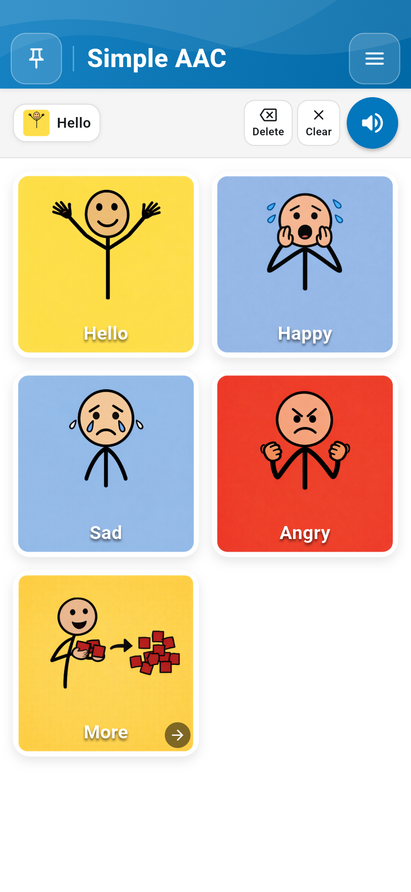 |
| :---: | :---: |
| *படம் 2.1: அட்டையைத் தொட்டதும் குரல் ஒலிக்கும் நேரடி மாதிரி* | *படம் 2.2: "Hello" அட்டையைத் தொட்டு வாக்கியப் பட்டையில் சேர்த்தல்* |

### 2.2 பல சொற்களைக் கொண்ட வாக்கியங்களை அமைத்தல் (Sentence Composer)

பயனர்கள் பல அட்டைகளை அடுத்தடுத்துத் தொடுவதன் மூலம் முழுமையான எண்ணங்களை அல்லது வாக்கியங்களை உருவாக்கலாம் (உதாரணமாக: *"Hello"* + *"Happy"*). வாக்கியப் பட்டையில் மூன்று முக்கிய கட்டுப்பாடுகள் உள்ளன:

- **Delete (பின்னோக்கி நீக்குதல்):** கடைசியாகச் சேர்த்த அட்டையை மட்டும் நீக்கும்.
- **Clear (அழித்தல்):** முழு வாக்கியப் பட்டையையும் ஒரே தொடுதலில் அழிக்கும்.
- **Speak Sentence (ஒலிபெருக்கி பொத்தான்):** உருவாக்கப்பட்ட முழு வாக்கியத்தையும் இடமிருந்து வலமாக சரளமாகப் பேசும்.

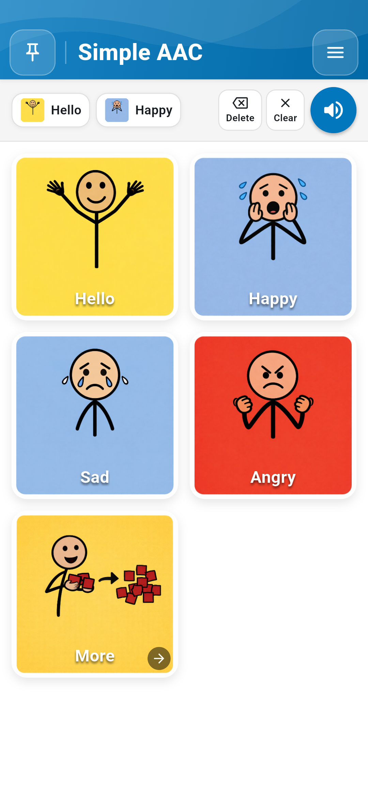  
*படம் 2.3: வாக்கிய அமைப்புப் பட்டையில் பல சொற்கள் கொண்ட வாக்கியங்களை உருவாக்குதல்*

---

## அத்தியாயம் 3 — அட்டைகளைத் தனிப்பயனாக்குதல் மற்றும் மும்மொழி ஆதரவு

ஒவ்வொரு நபரின் தொடர்பாடல் தேவைகளும் தனித்துவமானவை. பராமரிப்பாளர்கள், பேச்சுப் பயிற்சியாளர்கள் மற்றும் ஆசிரியர்கள் ஒவ்வொரு அட்டையின் படம், லேபிள் மற்றும் ஒலியை முழுமையாக மாற்றியமைக்கலாம்.

### 3.1 திருத்தும் முறைமை (Edit Mode) மற்றும் அட்டை திருத்தி (Card Editor)

அட்டைகளைத் தனிப்பயனாக்க, **Menu** (மேல் வலதுபுறம்) &rarr; **Enable Edit Mode** என்பதைத் தேர்ந்தெடுக்கவும். அட்டைகளின் மீது சிவப்பு நிற குப்பைத்தொட்டி ஐகான்களும், மேலே **Add New** பொத்தானும் தோன்றும். ஏதேனும் ஓர் அட்டையைத் தொடுவதன் மூலம் Card Editor உரையாடல் பெட்டி திறக்கும்.

| 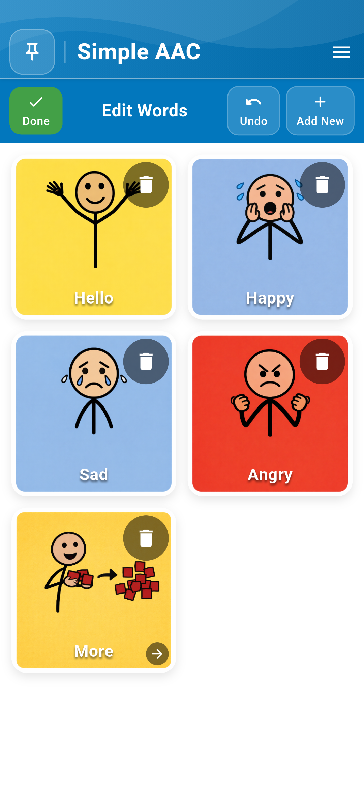 | 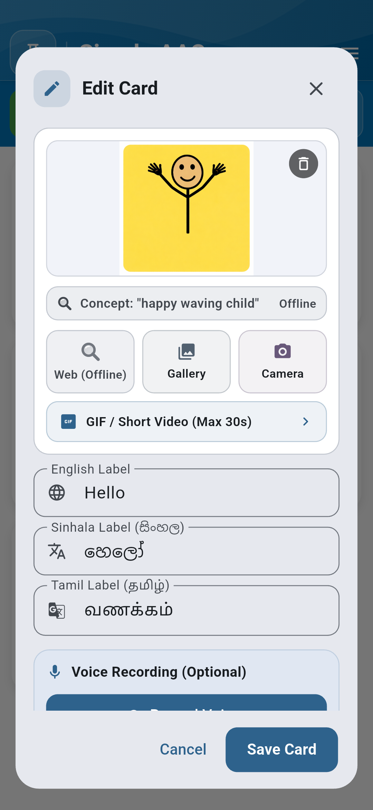 |
| :---: | :---: |
| *படம் 3.1: Add New பொத்தானுடன் கூடிய Edit Mode* | *படம் 3.2: அட்டை திருத்தும் கருவிப்பலகை (Card Editor)* |

### 3.2 நேரடிப் புகைப்படங்கள் மற்றும் Smart Search மூலம் படங்கள் சேர்த்தல்

- **Camera:** குழந்தை தினமும் பயன்படுத்தும் உண்மையான பொருட்கள் (தண்ணீர் போத்தல், விருப்பமான பொம்மை, குடும்ப உறுப்பினர்கள்) ஆகியவற்றை நேரடியாகப் படம் பிடிக்கவும். பயன்பாடு நிலையான Android அனுமதிகளைக் கேட்கும்.
- **Gallery:** சாதனத்தில் சேமிக்கப்பட்டுள்ள குடும்பப் புகைப்படங்கள் அல்லது சிகிச்சைக் குறியீடுகளைத் தேர்ந்தெடுக்கவும்.
- **Smart Image Search:** இணைய வசதி இருக்கும் போது, குழந்தைகளுக்குப் பொருத்தமான பாதுகாப்பான படத் தொகுப்பிலிருந்து படங்களைத் தேடிச் சேர்க்கலாம்.

|  | 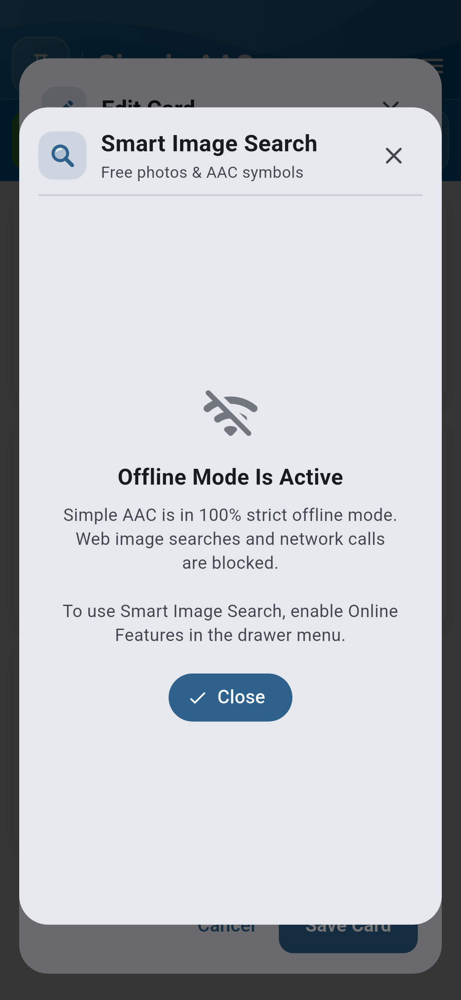 |
| :---: | :---: |
| *படம் 3.3: நேரடிப் புகைப்படக் கருவி மூலம் படம் பிடித்தல்* | *படம் 3.4: பாதுகாப்பான ஸ்மார்ட் படத் தேடல் (Smart Image Search)* |

### 3.3 மும்மொழி ஆதரவு (தமிழ், சிங்களம், ஆங்கிலம்) மற்றும் சொந்தக் குரல் பதிவு

Simple AAC இலங்கையின் உத்தியோகபூர்வ மொழிகள் மூன்றிற்கும் ஒரே நேரத்தில் ஆதரவளிக்கிறது: **ஆங்கிலம்** (எ.கா: *Hello*), **சிங்களம்** (*හෙලෝ*, *සතුටුයි*, *වතුර*), மற்றும் **தமிழ்** (*வணக்கம்*, *மகிழ்ச்சி*, *தண்ணீர்*). செயற்கைக் குரலை விட பழக்கமான குடும்பத்தினரின் குரலை விரும்பும் குழந்தைகளுக்காக, பெற்றோர் அல்லது பராமரிப்பாளர்கள் தங்கள் சொந்தக் குரலிலேயே சொற்களைப் பதிவு செய்ய முடியும்.

|  |  |
| :---: | :---: |
| *படம் 3.5: தமிழ், சிங்களம், ஆங்கிலம் ஆகிய மும்மொழி லேபிள்கள்* | *படம் 3.6: உயர்தர சொந்தக் குரல் பதிவு செய்யும் சாளரம்* |

---

## அத்தியாயம் 4 — இயங்குபடங்கள் (GIFs) மற்றும் வீடியோ லூப்கள்

ஆட்டிசம் பாதித்த குழந்தைகளுக்கு நிலையான படங்களை விட ஓர் அசைவை (உதாரணமாக: *குதித்தல்*, *தண்ணீர் குடித்தல்*, அல்லது *கை கழுவுதல்*) நேரடி இயக்கமாகப் பார்ப்பது எளிதில் புரியும். Simple AAC மின்கலத்தை (Battery) அதிகம் பயன்படுத்தாத வகையில் தொடர்ச்சியாக இயங்கும் GIF படங்களை அட்டைகளில் சேர்க்கும் வசதியை வழங்குகிறது.

| 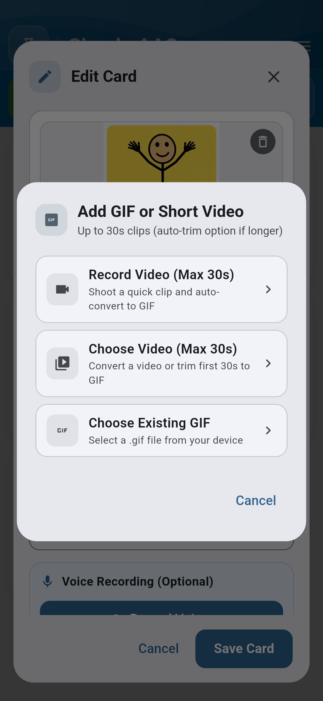 |  |
| :---: | :---: |
| *படம் 4.1: செயல்பாட்டு அட்டைகளுக்கான GIF இறக்குமதி* | *படம் 4.2: 30 விநாடி வீடியோவை GIF ஆக மாற்றும் வசதி* |

பராமரிப்பாளர்கள் 30 விநாடிகள் வரையிலான குறுகிய வீடியோக்களைப் (உதாரணமாக: சைகை மொழி, அன்றாட நடைமுறைகள்) பதிவு செய்து, அவற்றை பயன்பாட்டிற்குள்ளேயே மென்மையான இயங்குபடங்களாக (GIF) மாற்றிக் கொள்ளலாம்.

---

## அத்தியாயம் 5 — கோப்புறைகள் மற்றும் பிரிவுகளாக ஒழுங்கமைத்தல்

சொற்களின் எண்ணிக்கை அதிகரிக்கும் போது, அவற்றை *உணர்வுகள்*, *உணவு & பானங்கள்*, *பள்ளி*, மற்றும் *செயல்பாடுகள்* போன்ற பிரிவுகளாகக் கோப்புறைகளில் ஒழுங்கமைக்கலாம். ஒரு கோப்புறை அட்டையைத் தொடும் போது, மேல் வாக்கியப் பட்டை மாறாமல் அப்படியே இருக்க, அந்தப் பிரிவின் அட்டைகளுக்குள் எளிதாகச் செல்ல முடியும்.

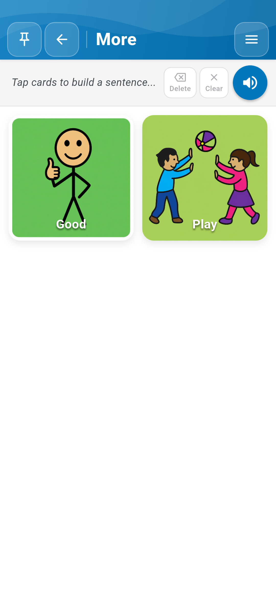  
*படம் 5.1: "More ->" கோப்புறைக்குள் சென்று அட்டைகளைப் பார்த்தல்*

---

## அத்தியாயம் 6 — தோற்றம், நிறக் கருப்பொருள்கள் மற்றும் தொடு அதிர்வு (Haptic Feedback)

### 6.1 அமைப்புகள் பட்டி (Settings Drawer) மற்றும் நேரடி நிற முன்னோட்டம்

மேல் வலதுபுறத்தில் உள்ள Menu பொத்தானைத் தொட்டு அமைப்புகள் பட்டியைத் திறக்கலாம். Simple AAC v1.1.0 பதிப்பில் நிகழ்நேர முன்னோட்டம் காட்டும் மேம்படுத்தப்பட்ட Color Pickers அறிமுகப்படுத்தப்பட்டுள்ளது:

| 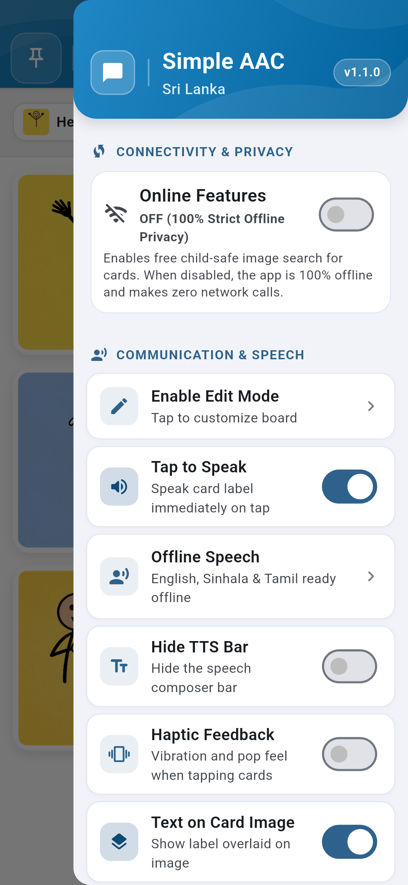 | 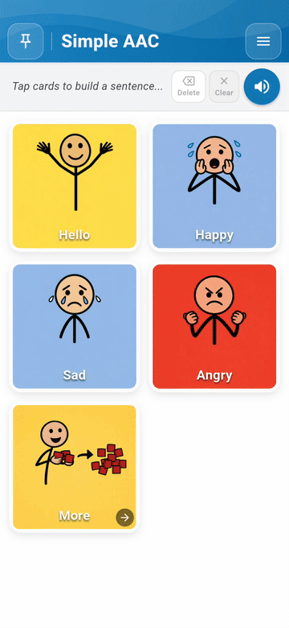 |
| :---: | :---: |
| *படம் 6.1: அமைப்புகள் பட்டி மற்றும் தோற்றத் தெரிவுகள்* | *படம் 6.2: நேரடி நிற மாற்றங்கள் முன்னோட்டம் (Animation)* |

### 6.2 மேம்படுத்தப்பட்ட நிறத் தெரிவிகள் (Redesigned Color Pickers)

முதன்மைப் பயன்பாட்டு நிறம், எழுத்துக்களின் நிறம், மற்றும் பலகையின் பின்னணி நிறம் ஆகியவற்றை நிகழ்நேர மாறுபட்ட விகித முன்னோட்டத்துடன் (Contrast preview) மாற்றியமைக்கலாம்:

| 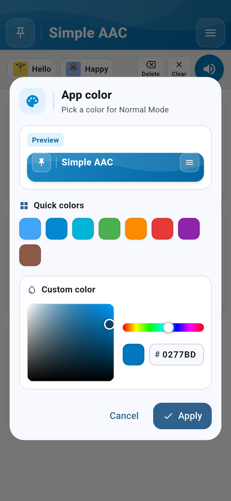 | 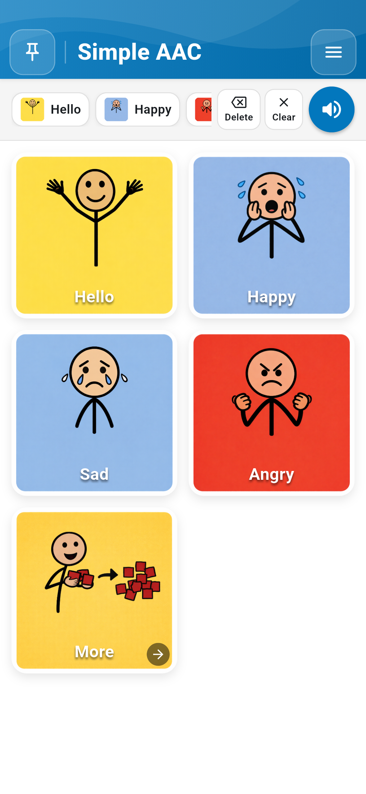 |  |
| :---: | :---: | :---: |
| *படம் 6.3: முதன்மை நிறத்தைத் தேர்ந்தெடுத்தல்* | *படம் 6.4: எழுத்து நிறத்தைத் தேர்ந்தெடுத்தல்* | *படம் 6.5: பலகைப் பின்னணி நிறத்தைத் தேர்ந்தெடுத்தல்* |

### 6.3 நிறக்குருடு ஆதரவு (Color-Blind Safe Mode) மற்றும் தொடு அதிர்வு

நிறங்களை அடையாளம் காண்பதில் சிரமம் உள்ளவர்களுக்காக (Color Blindness), WCAG AA வழிகாட்டுதல்களை பூர்த்தி செய்யும் **Color-Blind Safe Mode** வழங்கப்பட்டுள்ளது. மேலும், **Haptic Feedback** வசதி ஒவ்வொரு தொடுதலின் போதும் மெல்லிய அதிர்வை வழங்கி உறுதியளிக்கிறது.

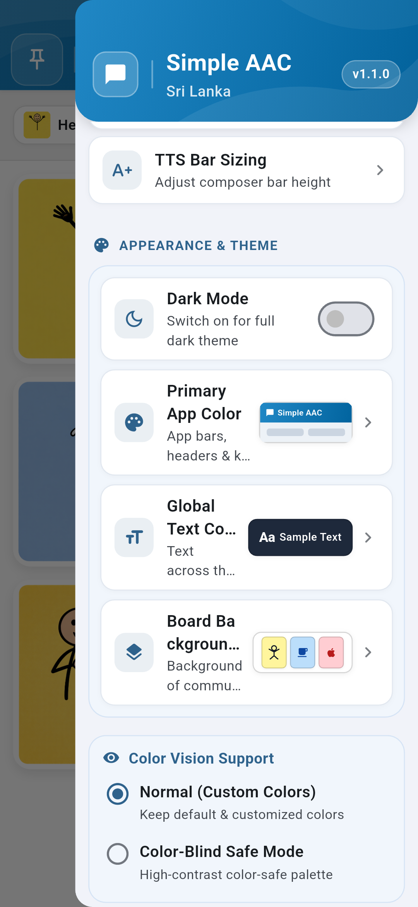  
*படம் 6.6: நிறக்குருடு ஆதரவு மற்றும் உயர் மாறுபட்ட அமைப்புகள்*

---

## அத்தியாயம் 7 — பாதுகாப்பு, பலகைப் பூட்டு மற்றும் குழந்தைகள் பூட்டு

### 7.1 PIN குறியீடு மூலம் பலகையைப் பூட்டுதல்

குழந்தைகள் தவறுதலாக அமைப்புகளை மாற்றுவதையோ அல்லது அட்டைகளை நீக்குவதையோ தடுக்க **Pin Board** பொத்தானைப் பயன்படுத்தவும். 4-இலக்க PIN குறியீட்டை அமைத்துப் பூட்டியவுடன், Settings Drawer மற்றும் Edit Mode ஆகியவை முடக்கப்பட்டு, பயமின்றி குழந்தையிடம் சாதனத்தை வழங்க முடியும்.

|  |  |
| :---: | :---: |
| *படம் 7.1: 4-இலக்க பாதுகாப்பு PIN அமைத்தல்* | *படம் 7.2: பலகை பூட்டப்பட்ட நிலையில் திருத்தங்கள் முடங்குதல்* |

---

## அத்தியாயம் 8 — தரவு காப்புப்பிரதி (Backup), மீட்டமைத்தல் (Restore) மற்றும் ஆஃப்லைன் தனியுரிமை

### 8.1 கடுமையான ஆஃப்லைன் தனியுரிமை மாதிரி (Strict Offline Privacy)

Simple AAC சாதனத்தில் மட்டுமே முழுமையாக இயங்குகிறது. பயனரின் தனிப்பட்ட புகைப்படங்கள், குரல் பதிவுகள் அல்லது தொடர்பாடல் பதிவுகள் எந்தவொரு வெளிப்புற சேவையகத்திற்கும் (Cloud) அனுப்பப்படுவதில்லை.

### 8.2 காப்புப்பிரதிகளை ஏற்றுமதி செய்தல் மற்றும் மீட்டமைத்தல் (Exporting & Restoring Backups)

- **Export Backup:** உங்கள் தனிப்பயன் அட்டைகள், புகைப்படங்கள், பதிவுகள் மற்றும் அமைப்புகளை ஒரே ZIP கோப்பாக சாதனத்தின் `Downloads` கோப்புறையில் சேமிக்கும்.
- **Import Restore:** முன்னர் ஏற்றுமதி செய்யப்பட்ட Simple AAC ZIP கோப்பைப் பாதுகாப்பாக சரிபார்த்து உடனடியாக மீட்டமைக்கும்.

| 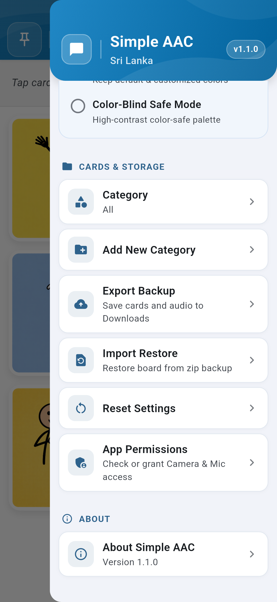 | 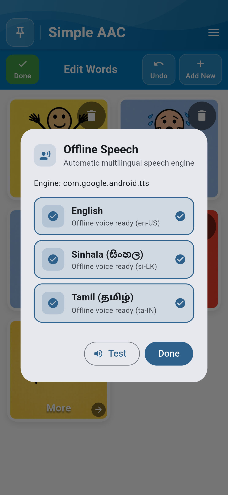 |
| :---: | :---: |
| *படம் 8.1: Cards & Storage அமைப்புகள் பகுதி* | *படம் 8.2: ஆஃப்லைன் பேச்சு TTS எஞ்சின் அமைப்புகள்* |

> **தரவு அணுமுறை நிலைத்தன்மை பற்றிய குறிப்பு (Note on Atomic Persistence):** Simple AAC அணுமுறை கோப்பு சேமிப்பு அமைப்பைப் (`aac_cards_v1.json` மற்றும் தானியங்கி `.bak` காப்புப்பிரதி) பயன்படுத்துகிறது. 1,000 க்கும் மேற்பட்ட அட்டைகளைக் கொண்ட பெரிய தரவுத்தொகுப்புகளுக்கும் முழுமையான தரவு ஒருமைப்பாடு சோதிக்கப்பட்டு உறுதிப்படுத்தப்பட்டுள்ளது.

---

*Simple AAC இலங்கை &bull; பதிப்பு 1.1.0 &bull; சுயமரியாதை, சுதந்திரம் மற்றும் நம்பகத்தன்மையுடன் குரல்களுக்கு வலுவூட்டுகிறது.*