# Simple AAC Sri Lanka - Complete User Guide (v1.1.6)

OFFICIAL USER DOCUMENTATION • VERSION 1.1.6 (BUILD 16)

  
# Simple AAC Sri Lanka

  
Complete Trilingual Augmentative & Alternative Communication Guide

  

    A comprehensive, practical manual designed for parents, caregivers, special educators, and speech therapists to empower non-verbal children and individuals with communication difficulties through intuitive visual communication cards and instant offline speech.
  

  

    

      Application Version:
      v1.1.6 (Production Build 16)
    

    

      Supported Languages:
      English (en-US), Sinhala (si-LK), Tamil (ta-IN)
    

    

      Operating System:
      Android 5.0 (API 21) to Android 15+ (Target SDK 34)
    

    

      Offline Architecture:
      100% Offline-First (No Internet / No Cloud Required)
    

    

      Package Identifier:
      lk.yasas.simpleaac
    

    

      Release Date:
      November 2026
    

  

  
Table of Contents

  

    
| **Quick Start Guide** — 5 Steps to First Communication | Page 2 
    
| **Chapter 1** — Getting Started & Everyday Navigation | Page 2 
    
| **Chapter 2** — Communicating with Speech & Sentence Composition | Page 3 
    
| **Chapter 3** — Communication Cards & Category Folders | Page 4 
    
| **Chapter 4** — Camera, Gallery & Multimedia Support | Page 5 
    
| **Chapter 5** — Appearance, Customisation & Accessibility | Page 6 
    
| **Chapter 6** — Caregiver Safety & Child Lock Protection | Page 7 
    
| **Chapter 7** — Data Backup, Restore & Offline Privacy | Page 7 
    
| **Chapter 8** — Troubleshooting & Frequently Asked Questions | Page 8 
  

  
# Quick Start Guide — 5 Steps to First Communication

Simple AAC Sri Lanka is designed for instant communication without complex setup. Follow these five simple steps to begin:

  - **Open the App:** Tap the Simple AAC icon on your home screen. The calming blue communication board opens immediately.

  - **Tap Any Card to Speak:** Tap the *Hello* card. The app speaks "Hello" instantly in clear, natural speech and highlights the card.

  - **Build a Sentence:** Tap *I want*, followed by *Water*. Both words appear in order on the top Sentence Composer bar.

  - **Speak the Sentence:** Tap the blue Speaker icon 🔊 on the right side of the sentence bar to vocalize the complete thought.

  - **Lock the Board (Optional):** Tap the Pin icon 📌 in the top-left corner to activate Caregiver Lock, preventing accidental changes while your child communicates.

> **TIP:** 
  
Caregiver Tip

  Place the tablet or phone on a stable surface or wheelchair tray at comfortable arm's length. Demonstrate tapping a card yourself ("modeling") so the child sees how touch produces voice.

  
# Chapter 1 — Getting Started & Everyday Navigation

  **Simple AAC Sri Lanka** is an augmentative and alternative communication (AAC) platform developed for children with speech delays, non-verbal autism spectrum conditions (ASD), cerebral palsy, Down syndrome, and aphasia. It operates 100% offline, keeping sensitive personal recordings and photos completely secure on your device.

## 1.1 Understanding the Home Screen

The screen is cleanly organized into three functional zones designed to avoid sensory overload:

  - **Top Navigation Bar:** Contains the **Pin Board** lock (left), the application title **Simple AAC** (centre), and the **Settings Drawer** button (right).

  - **Sentence Composer Bar:** Displays selected words in chronological sequence, complete with *Delete* (removes the last word), *Clear* (empties the bar), and the *Speak* button.

  - **Communication Grid:** High-contrast cards featuring friendly visual illustrations, clear bold typography, and pastel touch surfaces optimized for fine-motor control.

  

    <td class="screenshot-cell" style="width:50%;">
      
      
Figure 1.1: Home screen in Light Mode with high-contrast cards and sentence bar.

    </td>
    <td class="screenshot-cell" style="width:50%;">
      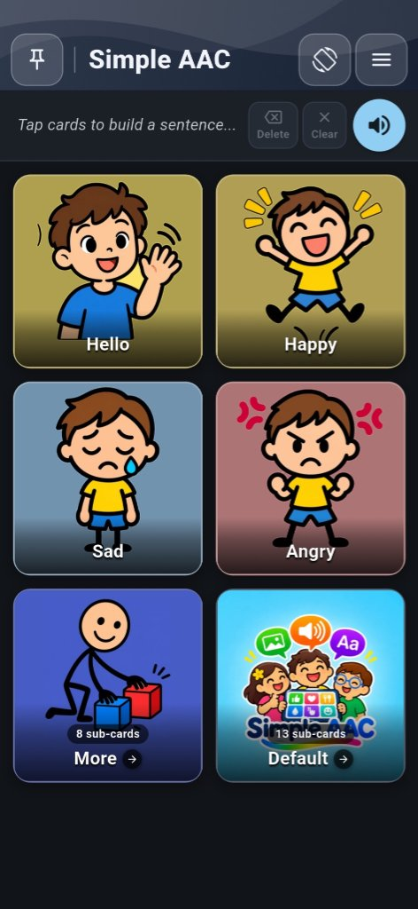
      
Figure 1.2: Home screen in Dark Mode with seamless pastel artwork integration.

    </td>
  

## 1.2 Category Navigation & Automatic Folder Memory

  Cards are organized into intuitive categories (e.g., *Needs*, *Feelings*, *Food*, *Animals*). Tapping a category folder opens its sub-cards. 
  A breadcrumb trail at the top (e.g., `Home &gt; Default &gt; Needs`) shows exactly where you are. Tap any breadcrumb segment or the Back arrow to return.

> **NOTE:** 
  
New in Build 16 — Automatic Folder Stack Recovery

  Simple AAC now automatically remembers your active folder path. If you switch to another app or the system temporarily restarts the app in the background, reopening Simple AAC returns you directly to your active folder without resetting to the home screen.

  
# Chapter 2 — Communicating with Speech & Sentence Composition

## 2.1 Instant Speech & Multi-Sensory Feedback

  Every tap provides immediate multi-sensory confirmation:

  - **Instant Voice Output:** Touching a card triggers immediate speech in English, Sinhala, or Tamil. In Build 16, background speech pre-warming ensures zero speech delay even on first touch.

  - **Visual Highlight:** The card gently expands with a bright visual border, reassuring the learner of their selection.

  - **Haptic Confirmation:** A gentle vibration (haptic feedback) confirms the touch for sensory-seeking children. Haptics can be adjusted or silenced in Settings.

## 2.2 Building Multi-Word Sentences

  For learners transitioning from single words to complete sentences, the horizontal **Sentence Composer bar** provides an intuitive sequencing space:

  - Tap the words in sequence: for example, `Hungry` &rarr; `Burger`.

  - Each card token appears inside the sentence bar with its thumbnail icon and text.

  - Tap the blue **Speak (🔊)** button. Simple AAC vocalizes the entire sentence naturally from start to finish.

  - Tap **Delete (⌫)** to remove the most recent card, or **Clear (✕)** to start a new sentence.

  

    <td class="screenshot-cell" style="width:50%;">
      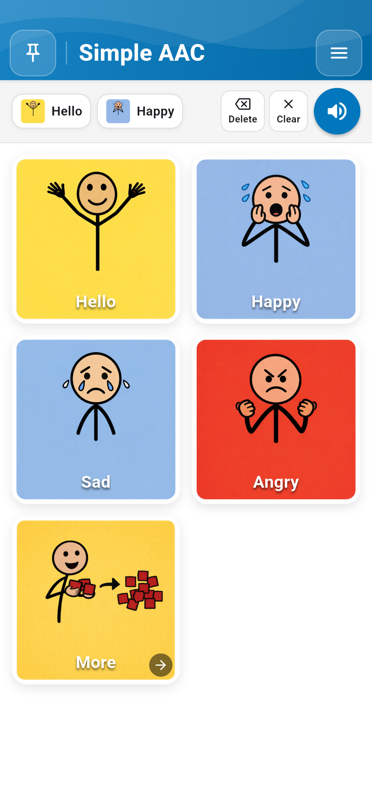
      
Figure 2.1: Sentence Composer bar holding active communication cards.

    </td>
    <td class="screenshot-cell" style="width:50%;">
      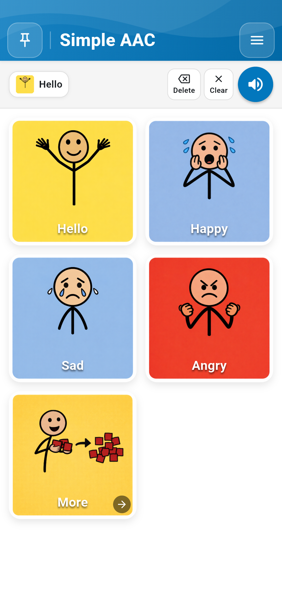
      
Figure 2.2: Instant speech feedback and visual card elevation.

    </td>
  

## 2.3 Trilingual Offline Speech (English, Sinhala, Tamil)

  Simple AAC supports Sri Lanka's three national languages natively. Speech generation is powered by on-device Text-to-Speech (TTS):

  - **English (en-US / en-GB):** Clear, expressive natural pronunciation.

  - **Sinhala (si-LK):** Native phonetic pronunciation of Sinhala vocabulary and phrases.

  - **Tamil (ta-IN / ta-LK):** Authentic Tamil pronunciation optimized for everyday phrases.

> **TIP:** 
  
Ensuring Offline Speech Works

  Ensure your device has the offline voice pack installed: On your Android device, navigate to **Settings &gt; System &gt; Language &amp; Input &gt; Text-to-Speech output &gt; Google Speech Recognition &amp; Synthesis &gt; Install voice data**, and download English, Sinhala, and Tamil for permanent offline availability.

  
# Chapter 3 — Communication Cards & Category Folders

## 3.1 The 13 Default Starter Pack Categories

  Simple AAC includes a comprehensive, pre-installed starter communication library organized into 13 high-frequency daily categories:

  - **Needs:** Urgent necessities (Hungry, Thirsty, Toilet, Help, Rest, Pain).

  - **Feelings:** Emotional states (Happy, Sad, Angry, Excited, Scared, Tired).

  - **Food &amp; Snacks:** Meals, fruits, snacks, and drinks commonly used in daily routines.

  - **Colours &amp; Shapes:** Fundamental descriptive concepts for educational sessions.

  - **Family &amp; People:** Mom, Dad, Teacher, Doctor, and key support figures.

  - **Animals, Actions, Places, Hygiene, Clothes, Toys &amp; School.**

  

    <td class="screenshot-cell" style="width:50%;">
      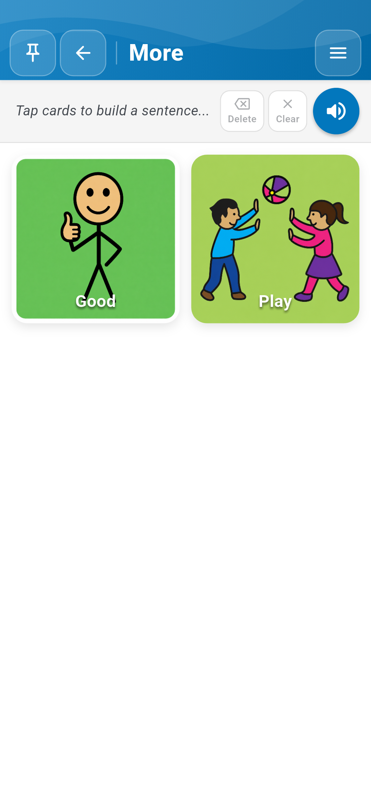
      
Figure 3.1: Category folder displaying categorized child-friendly vocabulary.

    </td>
    <td class="screenshot-cell" style="width:50%;">
      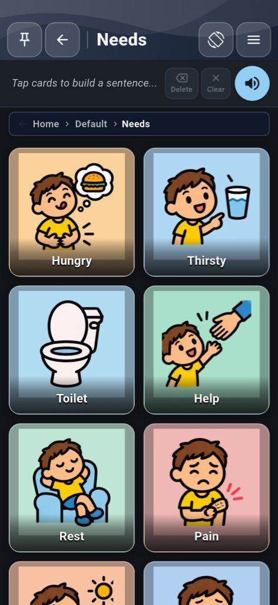
      
Figure 3.2: Needs category in Dark Mode featuring seamless perimeter fill.

    </td>
  

## 3.2 Creating &amp; Customising Cards

Caregivers can add unlimited custom cards to reflect the child's real life (family members, favourite toys, local foods):

  - Tap the Menu icon (☰) and toggle **Edit Mode** ON.

  - Tap the floating **+ (Add Card)** button.

  - Enter the **Card Label** (e.g., "Grandmother") and the **Spoken Text**.

  - Select an image using the Camera, Gallery, or built-in icon library.

  - Tap **Save**. The new card is immediately ready for communication.

  
# Chapter 4 — Camera, Gallery & Multimedia Support

## 4.1 Taking Real-World Photos with Camera

  Recognizing real-world objects and familiar faces is critical for many autistic children. Simple AAC makes camera capture effortless:

  - In the Card Editor, tap **Camera**.

  - Point the camera at the item (e.g., the child's water cup) and take the photo.

  - Confirm the photo. Simple AAC automatically returns to the Card Editor with the photo attached.

  - **Draft Protection:** If you take a photo or Android temporarily pauses the app, your entered card title and settings are completely preserved upon return.

## 4.2 Selecting Photos via Android Photo Picker

  Tap **Gallery** to choose existing photos. Simple AAC utilizes the modern, privacy-focused Android Photo Picker, granting access only to the exact photo you choose without scanning your personal storage.

  

    <td class="screenshot-cell" style="width:50%;">
      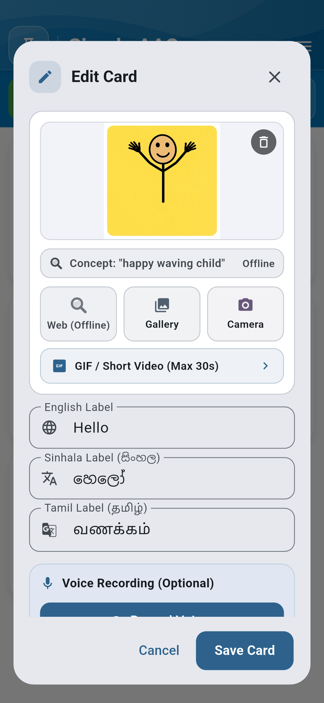
      
Figure 4.1: Camera photo capture integrated seamlessly into the Card Editor.

    </td>
    <td class="screenshot-cell" style="width:50%;">
      
      
Figure 4.2: Privacy-respecting Android Photo Picker for personal images.

    </td>
  

## 4.3 Animated GIFs &amp; Video-to-GIF Conversion

  Action concepts such as *Jump*, *Wash hands*, or *Dance* are far easier to comprehend through movement. Simple AAC supports animated GIF cards:

  - **Selecting Animated GIFs:** Choose any standard GIF from your gallery; it plays smoothly in an endless loop on the card.

  - **Convert Video to GIF:** Select a short video clip (up to 10 seconds). Simple AAC's native converter turns it into an optimized, battery-efficient GIF.

  - **Cooperative Cancellation (New in Build 16):** If you select the wrong video or wish to cancel processing, tapping **Cancel** or closing the dialog immediately halts the conversion in the background, cleans up temporary files, and returns you to editing without delays.

## 4.4 Recording Personal Voice Clips

  When a child prefers a mother's voice, a familiar teacher's voice, or specific local pronunciations, you can record custom audio:

  - In the Card Editor, scroll down to **Custom Voice Recording**.

  - Tap the red Microphone button 🎙️ and speak clearly.

  - Tap Stop. Tap Play ▶️ to review the recorded clip.

  - When this card is tapped on the board, Simple AAC plays the authentic human recording instead of the synthetic voice.

  

    <td class="screenshot-cell" style="width:50%;">
      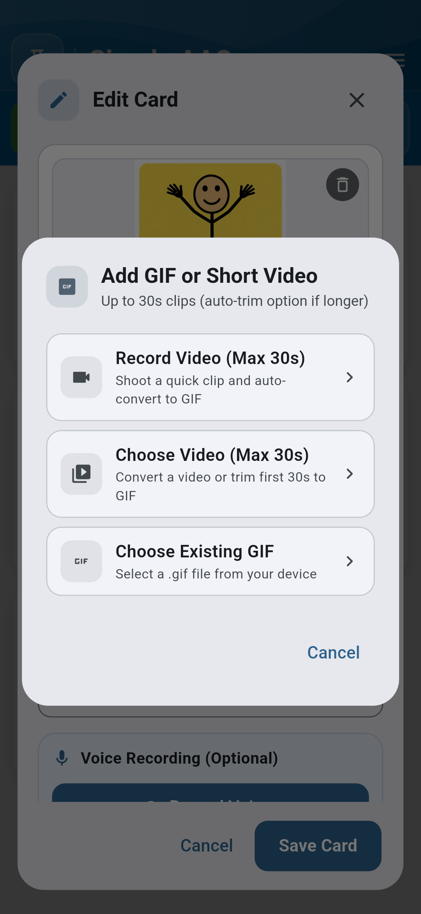
      
Figure 4.3: High-efficiency native Video-to-GIF encoder with cancel support.

    </td>
    <td class="screenshot-cell" style="width:50%;">
      
      
Figure 4.4: In-app voice recorder for personal parent and teacher recordings.

    </td>
  

  
# Chapter 5 — Appearance, Customisation & Accessibility

Every child has unique visual preferences and sensory requirements. Simple AAC offers rich appearance customisation:

## 5.1 Light Mode & Seamless Dark Mode

  Toggle between **Light Mode** (crisp, high-contrast white and soft pastel cards) and **Dark Mode** (deep slate background that prevents glare and eye fatigue during evening use).

> **NOTE:** 
  
New in Build 16 — Seamless Dark Mode Perimeter Fill

  In Dark Mode, starter category cards now dynamically match their background surface to the illustration's perimeter pastel colour. Inset dark borders have been completely eliminated across *Default*, *Needs*, *Animals*, and all sub-folders.

## 5.2 Text-to-Speech Bar Colour Setting (New in Build 16)

  Located in **Settings &gt; Appearance &amp; Theme** immediately below *Board Background Colour*:

  - **Custom Background:** Customise the background colour of the horizontal sentence-building bar.

  - **Independent Day/Night Persistence:** Choose independent colours for Light Mode and Dark Mode (e.g., Sky Blue for day, Deep Indigo for night).

  - **Live Mini Preview Chip:** The settings item displays a live interactive preview chip showing sample tokens (*Elephant*, *Fish*) and speaker icon.

  - **Dynamic Text Contrast:** Card token text automatically adapts between crisp black and pure white to ensure maximum readability against your chosen background colour.

  - **Professional Colour Picker:** Choose from quick accessible preset palettes or tap *Custom colour* for a full HSV gradient picker with hex code support.

  

    <td class="screenshot-cell" style="width:50%;">
      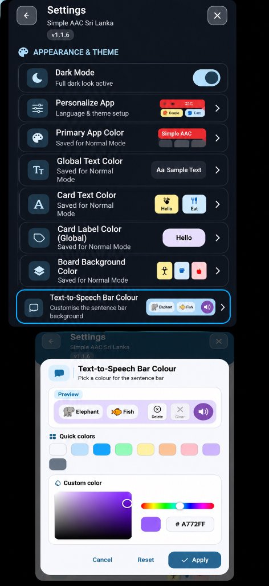
      
Figure 5.1: New Text-to-Speech Bar Colour setting with live preview & picker.

    </td>
    <td class="screenshot-cell" style="width:50%;">
      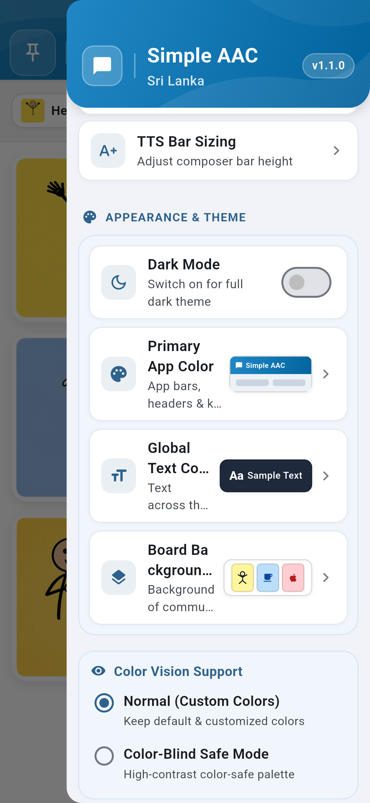
      
Figure 5.2: Colour Vision Support with Protanopia, Deuteranopia & Tritanopia modes.

    </td>
  

## 5.3 Card Label Visibility & Image Overlay Controls

Fine-tune how text labels appear on cards to suit emerging readers versus pre-readers:

  - **Show Card Labels:** Toggle ON to show labels, or OFF to display pure image-only flashcards.

  - **Overlay Card Labels:** When ON, labels float over the bottom of the artwork with a soft transparent gradient. When OFF, labels sit in a clean solid footer below the artwork.

  - **Global Card Label Background Colour:** Set a uniform background colour behind all card labels for optimal contrast.

## 5.4 Colour Vision Support & Layout Flexibility

  - **Colour Vision Modes:** Real-time visual adaptation for Protanopia (red-blind), Deuteranopia (green-blind), and Tritanopia (blue-blind).

  - **Grid Column Sizing:** Customise grid density from 1 column up to 12 columns. Simple AAC automatically optimizes card aspect ratios for phones and tablets in both portrait and landscape orientations.

  - **Open Settings Full Screen:** Toggle whether Settings opens as a compact slide-out drawer or an expansive full-screen view.

  - **British English UI:** All English interface text consistently uses British English terminology (*Colour*, *Colours*, *Customise*).

  

    <td class="screenshot-cell" style="width:50%;">
      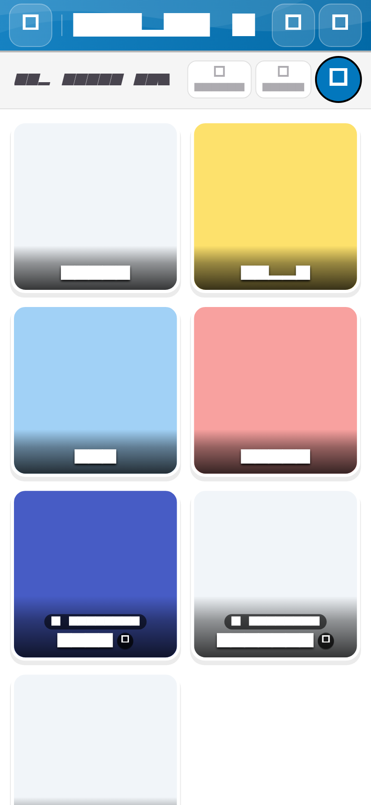
      
Figure 5.3: Visual Mode 1 — Text Overlay ON with gradient artwork blending.

    </td>
    <td class="screenshot-cell" style="width:50%;">
      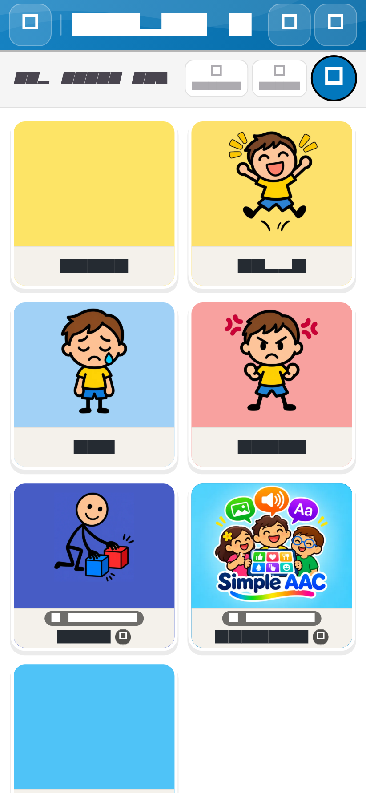
      
Figure 5.4: Visual Mode 2 — Text Overlay OFF with separate footer bar.

    </td>
  

  
# Chapter 6 — Caregiver Safety & Child Lock Protection

## 6.1 Activating Caregiver Lock (Pin Board Mode)

  Children exploring communication boards may accidentally tap menu items, delete cards, or alter settings. Simple AAC incorporates a tamper-proof **Caregiver Lock**:

  - Tap the **Pin icon (📌)** in the top-left corner of the header.

  - The application enters **Locked Mode**: the Settings Menu, Edit Mode, and Card Deletion buttons become completely inaccessible.

  - The child can freely communicate, tap cards, build sentences, and explore folders without risk.

  - To unlock, tap the Lock icon and enter your 4-digit security PIN.

  

    <td class="screenshot-cell" style="width:50%;">
      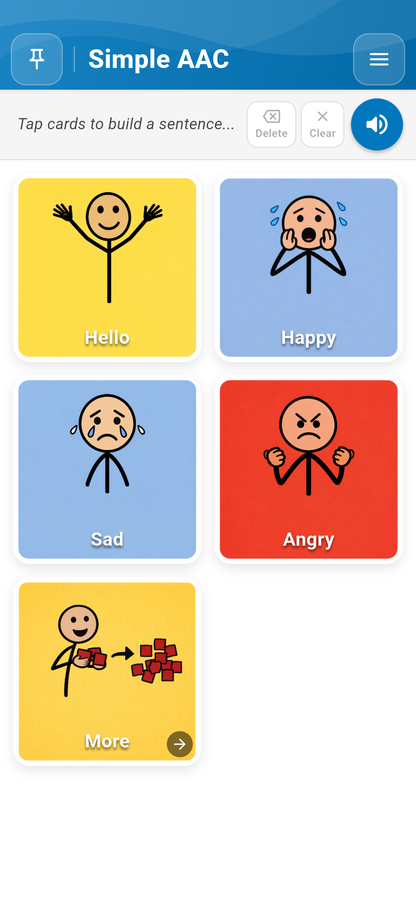
      
Figure 6.1: Secure 4-digit PIN setup protecting administrative settings.

    </td>
    <td class="screenshot-cell" style="width:50%;">
      
      
Figure 6.2: Locked Board Mode active: editing disabled for child safety.

    </td>
  

## 6.2 Setting and Resetting Your Security PIN

  - **Initial PIN:** When first enabling Caregiver Lock, enter any 4-digit PIN of your choice (e.g., `1234`).

  - **Master Unlock Safeguard:** If you ever forget your PIN, tap *Forgot PIN* and enter the master override key: `0000`.

  
# Chapter 7 — Data Backup, Restore & Offline Privacy

## 7.1 Creating a Complete Data Backup

  Never lose your customized cards, recorded voices, or photos. Simple AAC features an all-in-one export tool:

  - Open **Settings &gt; Backup &amp; Restore**.

  - Tap **Create Backup**.

  - Simple AAC compiles your communication database, custom images, animated GIFs, audio recordings, and theme preferences into a single encrypted `.zip` file.

  - Save the backup file to your device Downloads, an SD Card, or share it via Google Drive, WhatsApp, or email to a family member's phone.

## 7.2 Restoring onto a New Phone or Tablet

  Moving to a new tablet or sharing vocabulary between a child's home tablet and school tablet takes seconds:

  - Copy the backup file onto the new device.

  - Install Simple AAC, open **Settings &gt; Backup &amp; Restore**, and tap **Restore Backup**.

  - Select your backup file. Simple AAC safely verifies the archive and restores all cards, photos, recorded voices, and colors.

> **CAUTION:** 
  
Data Privacy & Security Guarantee

  Simple AAC operates 100% offline. It contains **zero external trackers, zero telemetry, and zero third-party advertising**. Your child's voice recordings, photos, and communication history are stored solely inside your device's private sandbox and are never uploaded to any remote server.

  
# Chapter 8 — Troubleshooting & Frequently Asked Questions

## 8.1 Common Questions & Quick Solutions

  

    <th style="padding:6px 8px; text-align:left; width:35%;">Symptom / Question</th>
    <th style="padding:6px 8px; text-align:left;">Solution & Step-by-Step Guidance</th>
  
  

    | Cards do not speak audio when tapped. 
    <td style="padding:6px 8px;">
      1. Check your tablet's **Media Volume** (buttons on device side). Ensure media is not muted.

      2. In Simple AAC Settings, verify **Tap to Speak** is switched ON.

      3. Verify your device has an active TTS engine installed (Google Speech Recognition &amp; Synthesis).
    </td>
  
  

    | Sinhala or Tamil speech is silent or sounds unnatural. 
    <td style="padding:6px 8px;">
      Android devices require the offline language data pack for Sinhala and Tamil. Go to Android **Settings &gt; System &gt; Language &gt; Text-to-Speech &gt; Google TTS settings &gt; Install voice data**, and tap download for Sinhala and Tamil.
    </td>
  
  

    | Camera or photo selection does not open. 
    <td style="padding:6px 8px;">
      Ensure Simple AAC has permission to use the camera: Go to Android **Settings &gt; Apps &gt; Simple AAC &gt; Permissions**, and grant *Camera* permission. For gallery images, Simple AAC uses the system Photo Picker which requires no storage permissions.
    </td>
  
  

    | I accidentally deleted an important card. 
    <td style="padding:6px 8px;">
      Cards are not immediately destroyed! Open **Settings &gt; Recycle Bin**. Locate your deleted card and tap **Restore** to return it to its original category.
    </td>
  
  

    | App reopened to the home screen instead of my folder. 
    <td style="padding:6px 8px;">
      In Build 16, active folders are automatically saved to internal memory. Simply resume Simple AAC from Android Recent Apps to maintain your exact sub-folder position.
    </td>
  
  

    | How do I backup my child's customized vocabulary? 
    <td style="padding:6px 8px;">
      Open **Settings &gt; Backup &amp; Restore &gt; Create Backup**. Save the generated zip file to Google Drive or an external USB flash drive every month for peace of mind.
    </td>
  

> **TIP:** 
  
Support & Community

  Simple AAC Sri Lanka was developed as an open accessibility initiative for Sri Lankan children and families. For feedback, community resources, and printable communication boards, visit our project repository or contact your local speech therapy center.
