# Simple AAC ශ්‍රී ලංකා - පරිශීලක අත්පොත (v1.1.6)

නිල පරිශීලක මාර්ගෝපදේශය • සංස්කරණය 1.1.6 (BUILD 16)

  
# Simple AAC ශ්‍රී ලංකා

  
විකල්ප සහ වර්ධක සන්නිවේදනය සඳහා වූ සම්පූර්ණ ත්‍රෛභාෂික අත්පොත

  

    කථන අපහසුතා සහ විශේෂ අවශ්‍යතා සහිත දරුවන්ට තම දෛනික අවශ්‍යතා, හැඟීම් සහ අදහස් රූපමය කාඩ්පත් සහ ක්ෂණික නොබැඳි කථනය (Offline Speech) මගින් පහසුවෙන් ප්‍රකාශ කිරීම සඳහා දෙමාපියන්, භාරකරුවන්, ගුරුවරුන් සහ කථන චිකිත්සකවරුන් වෙනුවෙන්ම සකස් කළ ප්‍රායෝගික මඟපෙන්වීම.
  

  

    

      මෘදුකාංග සංස්කරණය:
      v1.1.6 (නිෂ්පාදන Build 16)
    

    

      සහාය දක්වන භාෂා:
      සිංහල (si-LK), දෙමළ (ta-IN), ඉංග්‍රීසි (en-US)
    

    

      මෙහෙයුම් පද්ධතිය:
      Android 5.0 (Lollipop) සිට Android 15+ දක්වා
    

    

      නොබැඳි ක්‍රියාකාරිත්වය:
      100% Offline (අන්තර්ජාලය අවශ්‍ය නොවේ)
    

    

      පැකේජ හැඳුනුම් අංකය:
      lk.yasas.simpleaac
    

    

      නිකුත් කළ දිනය:
      2026 නොවැම්බර්
    

  

  
පටුන (Table of Contents)

  

    
| **කෙටි ආරම්භක මඟපෙන්වීම** — මුල්ම සන්නිවේදනය සඳහා පියවර 5 ක් | පිටුව 2 
    
| **1 වන පරිච්ඡේදය** — Simple AAC භාවිතය ආරම්භ කිරීම සහ සංචාලනය | පිටුව 2 
    
| **2 වන පරිච්ඡේදය** — කථනය සහ වාක්‍ය සකස් කිරීම | පිටුව 3 
    
| **3 වන පරිච්ඡේදය** — සන්නිවේදන කාඩ්පත් සහ කාණ්ඩ (Folders) | පිටුව 4 
    
| **4 වන පරිච්ඡේදය** — කැමරාව, පින්තූර ගැලරිය සහ මාධ්‍ය පහසුකම් | පිටුව 5 
    
| **5 වන පරිච්ඡේදය** — පෙනුම, වර්ණ තේමා සහ ප්‍රවේශ්‍යතාව (Accessibility) | පිටුව 6 
    
| **6 වන පරිච්ඡේදය** — භාරකරු අගුල (Caregiver Lock) සහ ළමා ආරක්ෂාව | පිටුව 7 
    
| **7 වන පරිච්ඡේදය** — දත්ත උපස්ථ කිරීම (Backup), නැවත ලබාගැනීම සහ රහස්‍යතාව | පිටුව 7 
    
| **8 වන පරිච්ඡේදය** — ගැටලු නිරාකරණය සහ නිතර අසන ප්‍රශ්න | පිටුව 8 
  

  
# කෙටි ආරම්භක මඟපෙන්වීම — මුල්ම සන්නිවේදනය සඳහා පියවර 5 ක්

Simple AAC ශ්‍රී ලංකා යෙදුම සංකීර්ණ සැකසුම්වලින් තොරව ක්ෂණික භාවිතය සඳහා සකසා ඇත. සන්නිවේදනය ඇරඹීමට මෙම සරල පියවර 5 අනුගමනය කරන්න:

  - **යෙදුම විවෘත කරන්න:** ඔබගේ දුරකථනයේ හෝ ටැබ්ලටයේ ඇති Simple AAC අයිකනය ස්පර්ශ කරන්න. නිල් පැහැති සන්සුන් පුවරුව ක්ෂණිකව විවෘත වේ.

  - **කාඩ්පතක් ස්පර්ශ කරන්න:** *හෙලෝ (Hello)* කාඩ්පත ස්පර්ශ කරන්න. යෙදුම ක්ෂණිකව පැහැදිලි සිංහල කටහඬින් "හෙලෝ" යැයි පවසමින් කාඩ්පත ඉස්මතු කරයි.

  - **වාක්‍යයක් ගොඩනගන්න:** *මට ඕනෙ (I want)* කාඩ්පත ස්පර්ශ කර, අනතුරුව *වතුර (Water)* කාඩ්පත ස්පර්ශ කරන්න. වචන දෙකම ඉහළ වාක්‍ය තීරුවේ පිළිවෙළින් සටහන් වේ.

  - **සම්පූර්ණ වාක්‍යයට සවන් දෙන්න:** වාක්‍ය තීරුවේ දකුණුපස ඇති නිල් පැහැති ස්පීකර් ලකුණ 🔊 ස්පර්ශ කරන්න. එවිට සම්පූර්ණ වාක්‍යයම එකවර කථා කරනු ඇත.

  - **පුවරුව අගුළු දමන්න (අවශ්‍ය නම්):** ඉහළ වම් කෙළවරේ ඇති පින් ලකුණ 📌 ස්පර්ශ කර භාරකරු අගුල (Caregiver Lock) සක්‍රීය කරන්න. එමගින් දරුවා අතින් අහඹු ලෙස කාඩ්පත් මැකී යාම වැළකේ.

> **TIP:** 
  
භාරකරුවන්ට උපදෙසක්

  දරුවා ඉදිරියේ ටැබ්ලටය පහසු දුරකින් තබන්න. දරුවාට පෙනෙන සේ ඔබ විසින්ම කාඩ්පතක් ස්පර්ශ කර කථා කරන අයුරු ආදර්ශයෙන් පෙන්වන්න (Modeling). එමගින් ස්පර්ශය මගින් ශබ්දය උපදින බව දරුවා පහසුවෙන් වටහා ගනී.

  
# 1 වන පරිච්ඡේදය — Simple AAC භාවිතය ආරම්භ කිරීම සහ සංචාලනය

  **Simple AAC ශ්‍රී ලංකා** යනු ඕටිසම් (Autism Spectrum), කථන ප්‍රමාදයන්, මස්තිෂ්ක අංශභාගය (Cerebral Palsy) හෝ වෙනත් සන්නිවේදන දුෂ්කරතා සහිත දරුවන් වෙනුවෙන්ම නිර්මාණය කරන ලද විකල්ප සන්නිවේදන මෘදුකාංගයකි. මෙය 100% ක්ම නොබැඳිව (Offline) ක්‍රියාත්මක වන අතර කිසිදු අන්තර්ජාල සම්බන්ධතාවයක් හෝ මුදල් ගෙවීමක් අවශ්‍ය නොවේ.

## 1.1 ප්‍රධාන තිරය හඳුනා ගැනීම

ප්‍රධාන අතුරුමුහුණත කාණ්ඩ තුනකින් සමන්විත වේ:

  - **ඉහළ සංචාලන තීරුව (Top Bar):** වම්පසින් ඇති **Pin Board** (ආරක්ෂිත අගුල), මැදින් ඇති **Simple AAC** නාමය සහ දකුණුපසින් ඇති **සැකසුම් මෙනුව (Settings)**.

  - **වාක්‍ය තීරුව (Sentence Composer Bar):** තෝරාගත් කාඩ්පත් පෙළගැසෙන සහ එකවර ශ්‍රවණය කළ හැකි ප්‍රදේශය. මෙහි *Delete* (අවසන් කාඩ්පත ඉවත් කිරීම), *Clear* (සම්පූර්ණ වාක්‍යය මකා දැමීම) සහ *Speak* (කථා කිරීමේ) බොත්තම් අඩංගු වේ.

  - **සන්නිවේදන කාඩ්පත් ජාලකය (Card Grid):** සියුම් ඇඟිලි චලනයන් අපහසු දරුවන්ට පවා පහසුවෙන් ස්පර්ශ කළ හැකි විශාල, ඉහළ ප්‍රතිවිරෝධතා (High-contrast) වර්ණ සහිත කාඩ්පත්.

  

    <td class="screenshot-cell" style="width:50%;">
      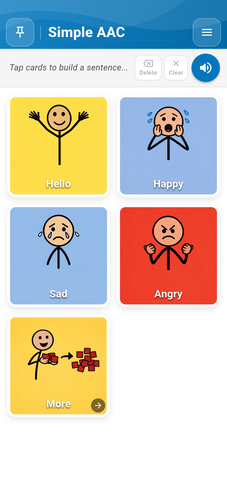
      
රූපය 1.1: ආලෝක මාදිලියේ (Light Mode) ප්‍රධාන තිරය සහ වාක්‍ය තීරුව.

    </td>
    <td class="screenshot-cell" style="width:50%;">
      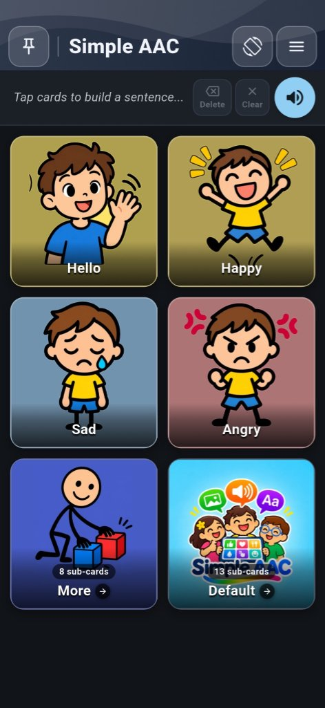
      
රූපය 1.2: අඳුරු මාදිලියේ (Dark Mode) මුල් තිරය එකඟ වූ වර්ණ සමඟින්.

    </td>
  

## 1.2 කාණ්ඩ සංචාලනය සහ ස්වයංක්‍රීය මතකය (Automatic Folder Recovery)

  කාඩ්පත් විවිධ මාතෘකා යටතේ (උදා: *අවශ්‍යතා*, *හැඟීම්*, *ආහාර*, *සතුන්*) ෆෝල්ඩර ලෙස ගොනු කර ඇත. ඉහළ ඇති මඟපෙන්වුම් පෙළ (Breadcrumbs - උදා: `Home &gt; Default &gt; Needs`) මඟින් ඔබ සිටින ස්ථානය දැකගත හැකි අතර ආපසු යාමට පසුපස ඊතලය ස්පර්ශ කරන්න.

> **NOTE:** 
  
Build 16 නව විශේෂාංගය — ස්වයංක්‍රීය ෆෝල්ඩර මතකය

  ඔබ යෙදුමෙන් තාවකාලිකව ඉවත් වී වෙනත් ඇප් එකකට ගියද හෝ දුරකථනය පසුබිමේදී යෙදුම නැවත පණගැන්වුවද, Simple AAC ඔබ අවසන් වරට රැඳී සිටි නිශ්චිත ෆෝල්ඩරය එලෙසම මතක තබා ගෙන නැවත විවෘත වේ.

  
# 2 වන පරිච්ඡේදය — කථනය සහ වාක්‍ය සකස් කිරීම

## 2.1 ක්ෂණික කථනය සහ බහුවිධ ප්‍රතිචාර

  දරුවා කාඩ්පතක් ස්පර්ශ කළ සැණින් බහුවිධ ඉන්ද්‍රිය ප්‍රතිචාර (Multi-sensory feedback) ලැබේ:

  - **ක්ෂණික කටහඬ (Instant Speech):** කාඩ්පත ස්පර්ශ කළ වහාම ප්‍රමාදයකින් තොරව පැහැදිලි හඬින් කථා කරයි. Build 16 හි පසුබිම් හඬ පෙර-සූදානම (Background Pre-warming) හේතුවෙන් ප්‍රථම ස්පර්ශයේදී පවා කිසිදු ප්‍රමාදයක් සිදු නොවේ.

  - **දෘශ්‍ය ඉස්මතු වීම (Visual Highlight):** කාඩ්පත වටා දීප්තිමත් මායිමක් මතුවෙමින් තේරීම තහවුරු කරයි.

  - **ස්පර්ශක කම්පනය (Haptic Pop):** ස්පර්ශ සංවේදනය ප්‍රිය කරන දරුවන් සඳහා සියුම් කම්පන ප්‍රතිචාරයක් ලැබේ. මෙය සැකසුම් මඟින් වෙනස් කිරීමට හෝ අක්‍රිය කිරීමට හැකිය.

## 2.2 බහු-වචන වාක්‍ය ගොඩනැගීම

  තනි වචනවලින් ඔබ්බට ගොස් සම්පූර්ණ අදහස් ප්‍රකාශ කිරීමට ඉහළ ඇති **වාක්‍ය තීරුව (Sentence Composer)** උපකාරී වේ:

  - අනුපිළිවෙලින් කාඩ්පත් ස්පර්ශ කරන්න: උදාහරණයක් ලෙස `මට බඩගිනියි` &rarr; `බත්`.

  - එක් එක් කාඩ්පත කුඩා අයිකනයක් සහ නම සහිතව වාක්‍ය තීරුවේ ස්ථානගත වේ.

  - නිල් පැහැති **ස්පීකර් බොත්තම (🔊)** ඔබන්න. සම්පූර්ණ වාක්‍යයම ස්වභාවික රිද්මයෙන් කථා කරනු ඇත.

  - අවසන් වචනය මකා දැමීමට **Delete (⌫)** ද, සම්පූර්ණ වාක්‍යයම ඉවත් කිරීමට **Clear (✕)** ද භාවිතා කරන්න.

  

    <td class="screenshot-cell" style="width:50%;">
      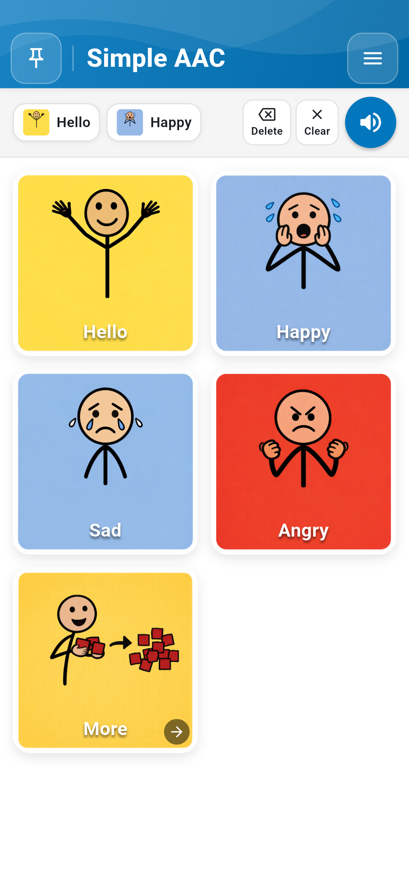
      
රූපය 2.1: වාක්‍ය ගොඩනගන තීරුව සක්‍රීය කාඩ්පත් සමඟින්.

    </td>
    <td class="screenshot-cell" style="width:50%;">
      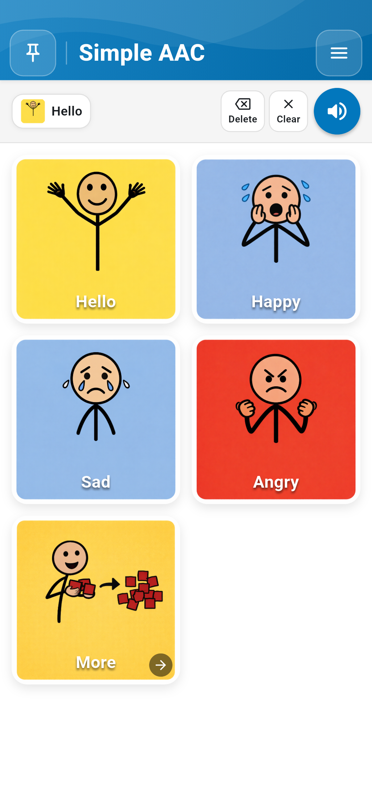
      
රූපය 2.2: කාඩ්පත ස්පර්ශ වූ විට ක්ෂණික ශබ්දය හා දෘශ්‍ය ඉස්මතු වීම.

    </td>
  

## 2.3 නොබැඳි භාෂා ත්‍රිත්වය (සිංහල, දෙමළ, ඉංග්‍රීසි)

  Simple AAC ශ්‍රී ලංකාවේ ප්‍රධාන භාෂා තුනෙන්ම ක්‍රියා කරයි. කථන ශබ්දය උපදවන්නේ ඔබගේ දුරකථනයේ ඇති නොබැඳි කථන එන්ජිම (Offline Text-to-Speech) මඟිනි:

  - **සිංහල (si-LK):** ශ්‍රී ලාංකික සිංහල වචන නිවැරදි උච්චාරණයෙන් කථා කරයි.

  - **දෙමළ (ta-IN / ta-LK):** දෛනික දෙමළ වචන සඳහා වූ පැහැදිලි උච්චාරණය.

  - **ඉංග්‍රීසි (en-US / en-GB):** පැහැදිලි, සරල ඉංග්‍රීසි කටහඬ.

> **TIP:** 
  
සිංහල කටහඬ නොඇසේ නම් කළ යුතු දේ

  දුරකථනයේ සිංහල හඬ පැකේජය බාගත කර ඇති බව තහවුරු කරගන්න: දුරකථනයේ **Settings &gt; System &gt; Language &gt; Text-to-Speech &gt; Google Speech Recognition &amp; Synthesis &gt; Install voice data** වෙත ගොස් Sinhala සහ Tamil තෝරා බාගත කරන්න.

  
# 3 වන පරිච්ඡේදය — සන්නිවේදන කාඩ්පත් සහ කාණ්ඩ (Folders)

## 3.1 පෙර-ස්ථාපිත කාණ්ඩ 13 (Default Starter Pack)

  Simple AAC හි දෛනික ජීවිතයට අත්‍යවශ්‍ය මූලික කාඩ්පත් 130 කට අධික ප්‍රමාණයක් කාණ්ඩ 13 කට බෙදා ඇතුළත් කර ඇත:

  - **අවශ්‍යතා (Needs):** බඩගිනියි, වතුර ඕනෙ, වැසිකිළිය, උදව්, විවේක, රිදෙනවා වැනි හදිසි අවශ්‍යතා.

  - **හැඟීම් (Feelings):** සතුටුයි, දුකයි, තරහයි, බයයි, මහන්සියි.

  - **ආහාර සහ කෙටි කෑම (Food &amp; Snacks):** බත්, පාන්, පළතුරු, කිරි, බිස්කට් ආදී ආහාර වර්ග.

  - **වර්ණ සහ හැඩතල (Colours &amp; Shapes):** අධ්‍යාපනික ක්‍රියාකාරකම් සඳහා මූලික සංකල්ප.

  - **පවුල සහ පුද්ගලයන් (Family &amp; People):** අම්මා, තාත්තා, ගුරුතුමිය, දොස්තර මහතා.

  - **සතුන්, ක්‍රියාකාරකම්, ස්ථාන, සනීපාරක්ෂාව, ඇඳුම්, සෙල්ලම් බඩු සහ පාසල.**

  

    <td class="screenshot-cell" style="width:50%;">
      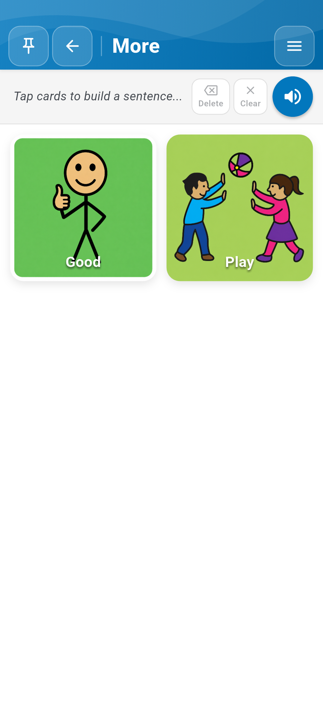
      
රූපය 3.1: ළමා සුහදශීලී කාණ්ඩ ෆෝල්ඩර දසුන.

    </td>
    <td class="screenshot-cell" style="width:50%;">
      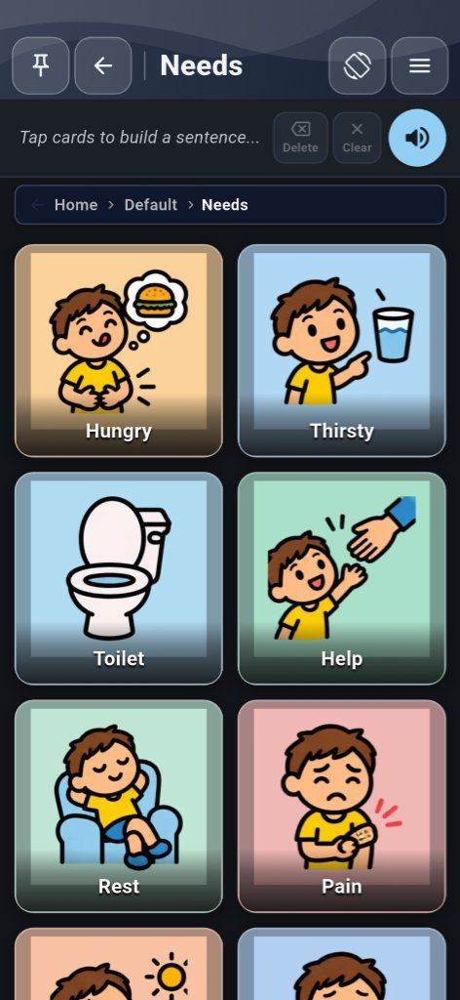
      
රූපය 3.2: අඳුරු මාදිලියේ අවශ්‍යතා ෆෝල්ඩරය පිරිපුන් පසුබිම් වර්ණ සහිතව.

    </td>
  

## 3.2 නව කාඩ්පත් නිර්මාණය කිරීම සහ සැකසීම

දරුවාගේ සැබෑ පරිසරයට ගැලපෙන පරිදි නව කාඩ්පත් එක් කළ හැක:

  - සැකසුම් මෙනුව (☰) විවෘත කර **සංස්කරණ මාදිලිය (Edit Mode)** සක්‍රීය කරන්න.

  - පහළින් දිස්වන **+ (කාඩ්පතක් එක් කරන්න)** බොත්තම ඔබන්න.

  - කාඩ්පතේ නම (උදා: "අත්තම්මා") සහ ශබ්ද නගා කිව යුතු වචනය ඇතුළත් කරන්න.

  - කැමරාව, ගැලරිය හෝ චිත්‍ර එකතුවෙන් පින්තූරයක් තෝරන්න.

  - **Save** ඔබන්න. නව කාඩ්පත සන්නිවේදනය සඳහා සූදානම් වේ.

  
# 4 වන පරිච්ඡේදය — කැමරාව, පින්තූර ගැලරිය සහ මාධ්‍ය පහසුකම්

## 4.1 කැමරාවෙන් සැබෑ ඡායාරූප ලබා ගැනීම

  ඕටිසම් දරුවන්ට සැබෑ ලෝකයේ වස්තූන් සහ හුරුපුරුදු මුහුණු පහසුවෙන් හඳුනාගත හැක:

  - කාඩ්පත් සංස්කාරකයේදී (Card Editor) **කැමරාව (Camera)** තෝරන්න.

  - අදාළ වස්තුව (උදා: දරුවාගේ වතුර බෝතලය) ඡායාරූපගත කරන්න.

  - ඡායාරූපය තහවුරු කරන්න. යෙදුම ස්වයංක්‍රීයව ඡායාරූපය කාඩ්පතට අමුණා සංස්කාරක තිරයට පැමිණේ.

  - **කෙටුම්පත් ආරක්ෂාව (Draft Protection):** ඡායාරූපය ලබා ගැනීමේදී ඔබ පෙර ඇතුළත් කළ ලේබල් හෝ සැකසුම් කිසිවක් මැකී නොගොස් සුරැකී පවතී.

## 4.2 දුරකථන ගැලරියෙන් පින්තූර තේරීම

  **Gallery** තේරූ විට, ඇන්ඩ්‍රොයිඩ් පද්ධතියේ නවීන සහ ආරක්ෂිත Photo Picker විවෘත වේ. එමගින් ඔබ තෝරාගන්නා නිශ්චිත ඡායාරූපයට පමණක් යෙදුමට ප්‍රවේශය ලැබෙන අතර ඔබගේ පුද්ගලික ගොනු සුරක්ෂිතව පවතී.

  

    <td class="screenshot-cell" style="width:50%;">
      
      
රූපය 4.1: කාඩ්පත් සංස්කාරකය තුළින්ම සෘජුවම කැමරාව භාවිත කිරීම.

    </td>
    <td class="screenshot-cell" style="width:50%;">
      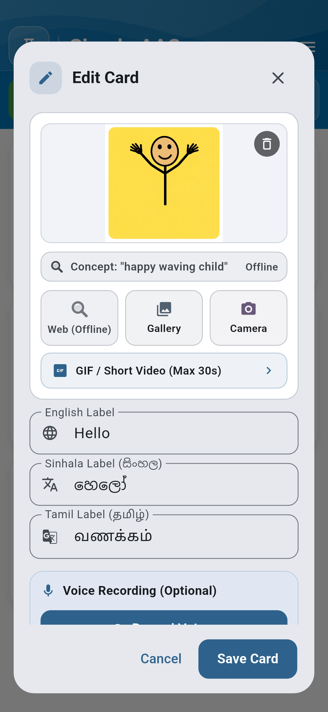
      
රූපය 4.2: රහස්‍යතාව සුරකින ඇන්ඩ්‍රොයිඩ් ඡායාරූප තෝරනය.

    </td>
  

## 4.3 චලන රූප (Animated GIFs) සහ වීඩියෝ GIF බවට පත් කිරීම

  *පනිනවා*, *අත් සෝදනවා*, *නටනවා* වැනි ක්‍රියාපද (Action words) චලනය වන රූප මගින් වඩාත් හොඳින් අවබෝධ කරගත හැක:

  - **GIF රූප භාවිතය:** ගැලරියේ ඇති ඕනෑම GIF රූපයක් තෝරාගත හැකි අතර එය කාඩ්පත මත නොනවත්වා චලනය වේ.

  - **වීඩියෝවක් GIF එකක් කිරීම:** තත්පර 10 කට අඩු කෙටි වීඩියෝවක් තෝරාගත් විට යෙදුම එය බැටරියට හිතකර GIF එකක් බවට පත් කරයි.

  - **ක්ෂණිකව අවලංගු කිරීම (Cooperative Cancellation):** වැරදි වීඩියෝවක් තේරී ඇත්නම්, **Cancel** බොත්තම එබූ සැණින් පරිවර්තනය ක්ෂණිකව නැවතී තාවකාලික ගොනු ඉවත් කර කිසිදු ඇනහිටීමකින් තොරව සංස්කාරකයට පිවිසේ.

## 4.4 පෞද්ගලික කටහඬ පටිගත කිරීම

  යන්ත්‍රයේ කටහඬ වෙනුවට මවගේ හෝ හුරුපුරුදු ගුරුවරියකගේ සැබෑ හඬින් කථා කිරීමට අවශ්‍ය නම්:

  - කාඩ්පත් සංස්කාරකයේ පහළ ඇති **Custom Voice Recording** වෙත යන්න.

  - රතු පැහැති මයික්‍රෆෝන ලකුණ 🎙️ ඔබා වචනය පැහැදිලිව පවසන්න.

  - Stop ඔබන්න. Play ▶️ ඔබා පටිගත වූ හඬ පරීක්ෂා කරන්න.

  - මෙම කාඩ්පත ස්පර්ශ කරන සෑම විටකම යන්ත්‍රයේ හඬ වෙනුවට ඔබ පටිගත කළ සැබෑ හඬ වාදනය වේ.

  

    <td class="screenshot-cell" style="width:50%;">
      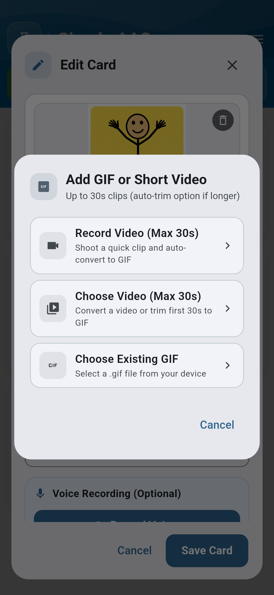
      
රූපය 4.3: කාර්යක්ෂම වීඩියෝ-GIF පරිවර්තකය අවලංගු කිරීමේ පහසුකම සමඟ.

    </td>
    <td class="screenshot-cell" style="width:50%;">
      
      
රූපය 4.4: දෙමාපියන්ගේ සැබෑ කටහඬ පටිගත කිරීමේ පහසුකම.

    </td>
  

  
# 5 වන පරිච්ඡේදය — පෙනුම, වර්ණ තේමා සහ ප්‍රවේශ්‍යතාව (Accessibility)

## 5.1 ආලෝක සහ අඳුරු මාදිලි (Light &amp; Dark Modes)

  දිවා කාලයේ භාවිතයට **ආලෝක මාදිලිය (Light Mode)** ද, රාත්‍රී කාලයේදී ඇස්වලට වෙහෙස නොවීමට සහ දීප්තිය පාලනයට **අඳුරු මාදිලිය (Dark Mode)** ද තෝරාගත හැක. Build 16 හිදී අඳුරු මාදිලියේ කාඩ්පත් පසුබිම් චිත්‍රවලට එකඟ වන සේ මනාව සකසා ඇත.

## 5.2 කථන තීරුවේ වර්ණය (Text-to-Speech Bar Colour - Build 16 නව විශේෂාංගය)

  **Settings &gt; Appearance &amp; Theme** හි *Board Background Colour* ට පහළින් මෙම නව සැකසුම පිහිටා ඇත:

  - **වාක්‍ය තීරුවේ පසුබිම වෙනස් කිරීම:** වාක්‍ය ගොඩනගන තීරුවේ පසුබිම් වර්ණය රුචි පරිදි වෙනස් කරගත හැක.

  - **දිවා/රාත්‍රී ස්වාධීන මතකය:** ආලෝක මාදිලිය සඳහා එක් වර්ණයක්ද (උදා: ලා නිල්), අඳුරු මාදිලිය සඳහා වෙනත් වර්ණයක්ද (උදා: තද දම්) ස්වාධීනව තෝරා තැබිය හැක.

  - **සජීවී පෙරදසුන (Live Preview Chip):** සැකසුම් මෙනුව තුළම කුඩා වාක්‍ය තීරුවක පෙරදසුනක් (Elephant, Fish කාඩ්පත් සමඟ) සජීවීව දිස්වේ.

  - **ස්වයංක්‍රීය අකුරු ප්‍රතිවිරෝධය:** ඔබ තෝරාගන්නා පසුබිම් වර්ණයට ගැලපෙන සේ අකුරු කළු හෝ සුදු පැහැයට ස්වයංක්‍රීයව හැරී උපරිම කියවීමේ පහසුව ලබා දෙයි.

  - **වර්ණ තෝරනය:** සකස් කළ ක්ෂණික වර්ණ මාලාවකින් හෝ *Custom colour* මඟින් ඕනෑම වර්ණයක් තෝරාගත හැක.

  

    <td class="screenshot-cell" style="width:50%;">
      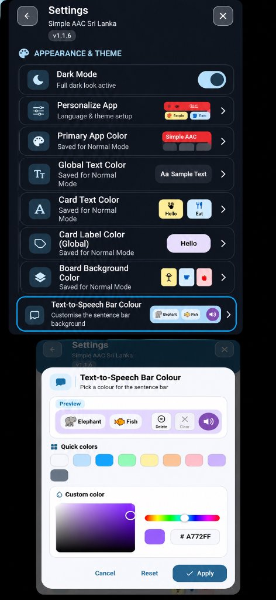
      
රූපය 5.1: කථන තීරුවේ වර්ණය තේරීමේ නව සැකසුම සහ වර්ණ තෝරනය.

    </td>
    <td class="screenshot-cell" style="width:50%;">
      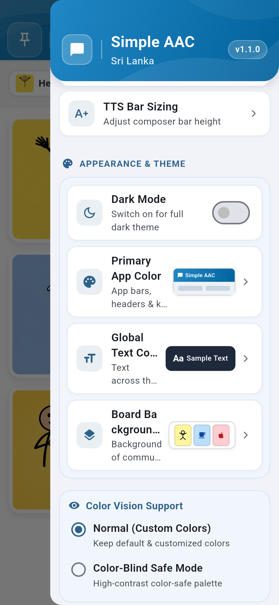
      
රූපය 5.2: වර්ණ අන්ධතා සහාය (Colour Vision Support) සැකසුම්.

    </td>
  

## 5.3 කාඩ්පත් ලේබල් පාලනය (Label Visibility &amp; Overlay)

  - **කාඩ්පත් ලේබල් පෙන්වීම (Show Card Labels):** අකුරු කියවීමට නොහැකි කුඩා දරුවන් සඳහා ලේබල් සඟවා පින්තූරය පමණක් (Flashcard) පෙන්වීමට මෙය අක්‍රිය කළ හැක.

  - **පින්තූරය මත ලේබලය තැබීම (Overlay Card Labels):** සක්‍රීය කළ විට අකුරු පින්තූරයේ පහළින් මෘදුව පාවෙන සේ දිස්වේ. අක්‍රිය කළ විට පින්තූරයට පහළින් වෙනම තීරුවක අකුරු පිහිටයි.

  - **ගෝලීය ලේබල් පසුබිම් වර්ණය (Card Label Colour Global):** සියලුම කාඩ්පත්වල ලේබල් සඳහා පොදු පසුබිම් වර්ණයක් යෙදිය හැක.

## 5.4 වර්ණ අන්ධතා සහාය සහ ජාලක ප්‍රමාණය

  - **වර්ණ අන්ධතා ප්‍රකාර (Colour Vision Modes):** Protanopia, Deuteranopia, Tritanopia සහිත දරුවන්ට වර්ණ හඳුනා ගැනීමට පහසු වෙනස්කම්.

  - **තීරු ගණන වෙනස් කිරීම:** පුවරුවේ තිරස් තීරු ගණන 1 සිට 12 දක්වා දරුවාගේ ඇඟිලි පාලනයට අනුව සකසා ගත හැක.

  - **සැකසුම් සම්පූර්ණ තිරයෙන් පෙන්වීම (Open Settings Full Screen):** සැකසුම් මෙනුව කුඩා තීරුවක් ලෙස හෝ සම්පූර්ණ තිරය පුරා විවෘත වන සේ සැකසීමේ හැකියාව.

  

    <td class="screenshot-cell" style="width:50%;">
      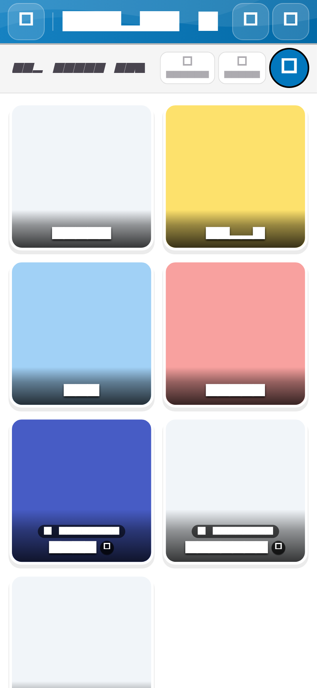
      
රූපය 5.3: දෘශ්‍ය මාදිලිය 1 — පින්තූරය මත ලේබලය පිහිටන අයුරු (Overlay ON).

    </td>
    <td class="screenshot-cell" style="width:50%;">
      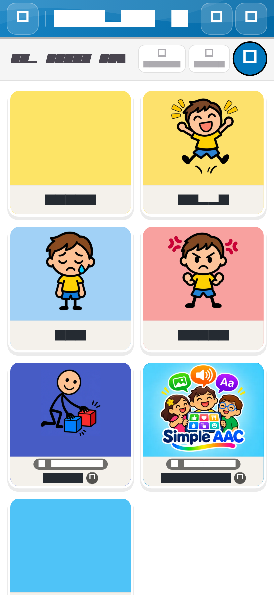
      
රූපය 5.4: දෘශ්‍ය මාදිලිය 2 — පින්තූරයට පහළින් ලේබලය පිහිටන අයුරු (Overlay OFF).

    </td>
  

  
# 6 වන පරිච්ඡේදය — භාරකරු අගුල (Caregiver Lock) සහ ළමා ආරක්ෂාව

## 6.1 භාරකරු අගුල සක්‍රීය කිරීම (Pin Board Mode)

  දරුවන් පුවරුව භාවිත කිරීමේදී අහඹු ලෙස මෙනු විවෘත කිරීම හෝ කාඩ්පත් මකා දැමීම වැළැක්වීමට මෙම අගුල යොදන්න:

  - ඉහළ වම් කෙළවරේ ඇති **පින් ලකුණ (📌)** ස්පර්ශ කරන්න.

  - පුවරුව අගුළු වැටේ (Locked Mode). සැකසුම් මෙනුව සහ සංස්කරණ බොත්තම් සම්පූර්ණයෙන්ම සැඟවී යයි.

  - දරුවාට කිසිදු බාධාවකින් තොරව නිදහසේ කාඩ්පත් ස්පර්ශ කර කථා කළ හැක.

  - නැවත විවෘත කිරීමට අගුලේ ලකුණ ඔබා ඔබගේ ඉලක්කම් 4 රහස් අංකය (PIN) ඇතුළත් කරන්න.

  

    <td class="screenshot-cell" style="width:50%;">
      
      
රූපය 6.1: ඉලක්කම් 4 කින් යුත් ආරක්ෂිත PIN අංකය සැකසීම.

    </td>
    <td class="screenshot-cell" style="width:50%;">
      
      
රූපය 6.2: අගුළු දැමූ පුවරුව: දරුවාගේ ආරක්ෂාව වෙනුවෙන් සංස්කරණය අක්‍රියයි.

    </td>
  

## 6.2 PIN අංකය කළමනාකරණය

  - **මූලික PIN අංකය:** ප්‍රථම වරට අගුල යොදන විට ඔබට කැමති ඉලක්කම් 4 ක අංකයක් ඇතුළත් කරන්න (උදා: `1234`).

  - **PIN අංකය අමතක වුවහොත්:** *Forgot PIN* තෝරා ප්‍රධාන මුදාහැරීමේ අංකය (Master PIN) වන `0000` ඇතුළත් කරන්න.

  
# 7 වන පරිච්ඡේදය — දත්ත උපස්ථ කිරීම (Backup), නැවත ලබාගැනීම සහ රහස්‍යතාව

## 7.1 සම්පූර්ණ දත්ත උපස්ථයක් (Backup) සෑදීම

  ඔබ මහන්සියෙන් සකස් කළ කාඩ්පත්, පටිගත කළ කටහඬවල් හෝ ඡායාරූප කිසිදා අහිමි නොවන සේ සුරක්ෂිත කරගන්න:

  - **Settings &gt; Backup &amp; Restore** වෙත යන්න.

  - **Create Backup** ඔබන්න.

  - සියලුම කාඩ්පත්, ඡායාරූප, GIF රූප, හඬ පටිගත කිරීම් සහ වර්ණ සැකසුම් තනි `.zip` ගොනුවක් ලෙස සුරැකේ.

  - මෙම ගොනුව Google Drive, WhatsApp හෝ ඊමේල් මගින් වෙනත් දුරකථනයකට යවා තබා ගන්න.

## 7.2 නව දුරකථනයකට හෝ ටැබ්ලටයකට දත්ත ඇතුළත් කිරීම

  - සුරක්ෂිත කරගත් Backup ගොනුව නව දුරකථනයට පිටපත් කරන්න.

  - Simple AAC ස්ථාපනය කර **Settings &gt; Backup &amp; Restore &gt; Restore Backup** තෝරන්න.

  - Backup ගොනුව තේරූ සැණින් පෙර තිබූ සියලුම කාඩ්පත් සහ සැකසුම් ක්ෂණිකව නැවත ස්ථාපනය වේ.

> **CAUTION:** 
  
100% නොබැඳි රහස්‍යතා සහතිකය

  Simple AAC කිසිදු බාහිර සේවාදායකයකට (Servers) සම්බන්ධ නොවේ. ඔබගේ දරුවාගේ ඡායාරූප, පටිගත කළ හඬවල් සහ සන්නිවේදන දත්ත ඔබගේ දුරකථනය තුළ පමණක් සුරක්ෂිතව පවතින අතර අන්තර්ජාලයට උඩුගත නොවේ.

  
# 8 වන පරිච්ඡේදය — ගැටලු නිරාකරණය සහ නිතර අසන ප්‍රශ්න

## 8.1 නිතර අසන ගැටලු සහ සරල පිළියම්

  

    <th style="padding:6px 8px; text-align:left; width:35%;">ගැටලුව / රෝග ලක්ෂණය</th>
    <th style="padding:6px 8px; text-align:left;">විසඳුම සහ පියවර</th>
  
  

    | කාඩ්පත් ස්පර්ශ කළද ශබ්දය නොඇසේ. 
    <td style="padding:6px 8px;">
      1. දුරකථනයේ මාධ්‍ය ශබ්ද මට්ටම (Media Volume) වැඩි කරන්න.

      2. Simple AAC සැකසුම්වල **Tap to Speak** සක්‍රීය දැයි බලන්න.

      3. දුරකථනයේ Google Speech Recognition &amp; Synthesis එන්ජිම ක්‍රියාත්මක දැයි පරීක්ෂා කරන්න.
    </td>
  
  

    | සිංහල හෝ දෙමළ වචන නිවැරදිව කථා නොකරයි. 
    <td style="padding:6px 8px;">
      දුරකථනයට නොබැඳි සිංහල හඬ ගොනුව බාගත කළ යුතුය: දුරකථනයේ **Settings &gt; System &gt; Language &gt; Text-to-Speech &gt; Google TTS &gt; Install voice data** වෙත ගොස් Sinhala බාගත කරන්න.
    </td>
  
  

    | කැමරාව විවෘත නොවේ. 
    <td style="padding:6px 8px;">
      Simple AAC සඳහා කැමරා අවසරය ලබාදී ඇත්දැයි බලන්න: දුරකථනයේ **Settings &gt; Apps &gt; Simple AAC &gt; Permissions** වෙත ගොස් Camera අවසරය ලබා දෙන්න.
    </td>
  
  

    | අත්වැරදීමකින් කාඩ්පතක් මැකී ගියේය. 
    <td style="padding:6px 8px;">
      බිය නොවන්න! කාඩ්පත කෙළින්ම මැකී නොයයි. **Settings &gt; Recycle Bin** වෙත ගොස් අදාළ කාඩ්පත තෝරා **Restore** ඔබන්න.
    </td>
  
  

    | ඇප් එක නැවත විවෘත කළ විට මුල් තිරයට යයිද? 
    <td style="padding:6px 8px;">
      නැත, Build 16 හි ස්වයංක්‍රීය මතකය මගින් ඔබ සිටි ෆෝල්ඩරය එලෙසම රඳවා ගනී. Android Recent Apps මගින් ඇප් එක තෝරන්න.
    </td>
  
  

    | දරුවාගේ වචන එකතුව ආරක්ෂා කරගන්නේ කෙසේද? 
    <td style="padding:6px 8px;">
      මසකට වරක් **Settings &gt; Backup &amp; Restore &gt; Create Backup** මඟින් Backup එකක් සාදා ඔබගේ ඊමේල් හෝ Google Drive හි තබා ගන්න.
    </td>
  

> **TIP:** 
  
සහයෝගය සහ ප්‍රජාව

  Simple AAC ශ්‍රී ලංකා යනු ශ්‍රී ලාංකික දරුවන්ගේ සන්නිවේදන ප්‍රවේශ්‍යතාව වෙනුවෙන් කැපවූ විවෘත ව්‍යාපෘතියකි. වැඩිදුර තොරතුරු සහ උපකාර සඳහා ඔබගේ ප්‍රදේශයේ කථන හා භාෂා චිකිත්සක සායනය (Speech Therapy Clinic) අමතන්න.
